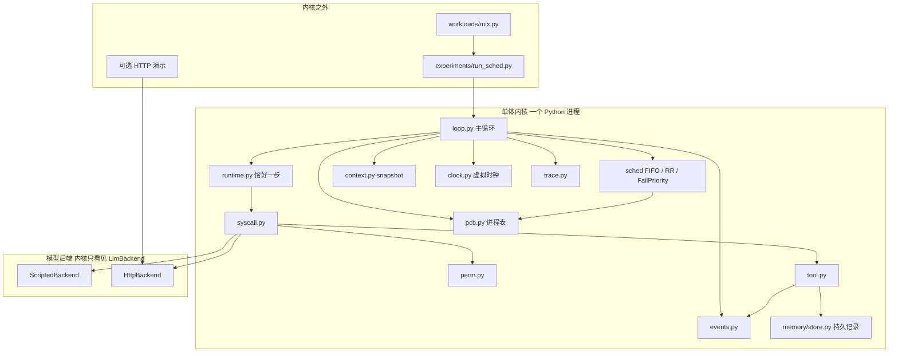
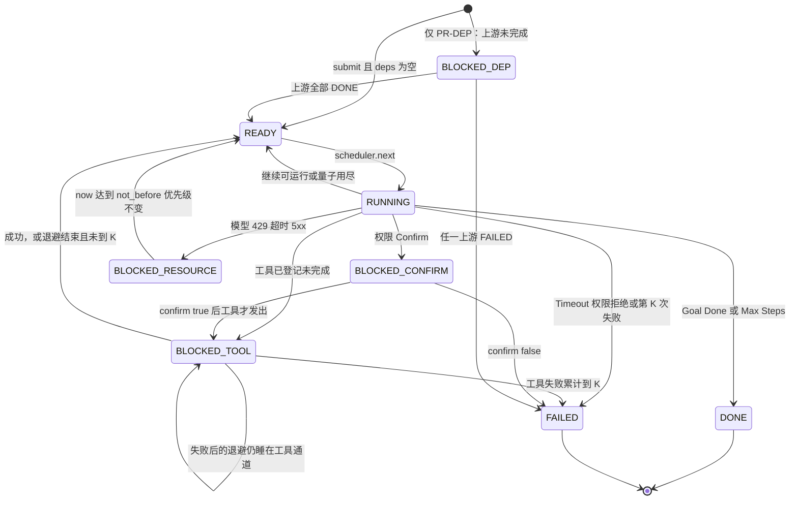

# AgentOS 课程内核设计：以系统调用为粒度的失败感知调度

| 项 | 内容 |
| --- | --- |
| 课程 | 南京大学《操作系统：设计与实现》期末大作业 |
| 文档 | 小型 AgentOS 内核，深入调度，其余子系统做薄但真实存在 |
| 作者 | 课程项目小组 |
| 日期 | 2026-11-03 |
| 状态 | Draft |
| 读者 | 课程老师；2–4 人实现小组（熟悉进程、PCB、就绪队列、上下文切换、系统调用、阻塞/唤醒、MLFQ） |
| 实现语言 | Python 3.11+，标准库优先，测试用 pytest |
| 代码状态 | 绿地。当前工作区只有课件 `L10-期末大作业agentos.pdf`，没有任何内核代码。下文每个源码路径都是**待创建的新文件** |

---

## Overview

本设计实现一个单进程、单线程、内存队列的单体内核。一个 Agent 任务是一个进程，有 PCB。调度器调度的不是“把整个任务跑完”，而是这个进程的**一次内核操作**：一次 `llm_generate`，或一次工具调用的发起。模型是 CPU，工具是 I/O。运行时每次只执行恰好一步，把 `StepResult` 交还调度器。

周边模块都存在，但只做到调度器需要的深度：上下文保存/恢复使抢占后能从正确的步继续；系统调用路径做参数校验、权限检查、执行、返回观测；权限表给出 Allow / Confirm / Deny；轨迹记录 `sched_switch` 一类事件；持久记忆只是一份很小的已完成任务记录。不实现虚拟内存、CFS、消息总线、向量库，也不把多 Agent 社会当作主题。

调度策略实现三个，并可消融：FCFS、以 token 为时间片的 Round-Robin、失败感知优先级。失败感知策略是优先级带、I/O 完成加分、等待老化、以及按失败类型加减优先级的组合，不是一套新名词。实验负载是几十个脚本任务，数字必须可重复。文档里的性能预期都是**待实验验证的假设**，不是已测结果。

这是课程内核，不是生产 Agent 平台。安全模型是演示级。开发窗口是第 15–16 周，设计在第 11–12 周冻结。

## Background & Motivation

课件要求 AgentOS 在 Agent 执行前回答五件事：用什么模型、能用什么工具、记住什么、允许什么操作、何时执行，并监控过程。和传统 OS 的对应是：进程/线程 → Runtime，地址空间/上下文 → State，CPU 调度 → Scheduler，IPC → 消息或共享状态，系统调用 → Tool call。Runtime 循环是 Build Context → LLM Decide → Tool Execute → Update State。终止条件是 Goal Done、Max Steps、Timeout、Error。

这些模块如果都做成研究系统，两周写不完，而且会把作业做成另一个 Agent 框架。Camel、Hermes、AG2、UFO 是 Agent **应用框架**，不采用它们的内核结构。AIOS 把 LLM 服务从 Agent 应用里拆进内核，调度器按系统调用分发，context manager 做 snapshot/restore。本设计只采纳这两点：调度单位是 syscall，切换时 snapshot/restore。不实现 AIOS 的向量存储、LSFS、多 LLM 适配矩阵，也不实现 AIOS 在一次生成内部打断解码的 logits 快照。

当前痛点不是“缺少一个聊天程序”，而是：如果 Runtime 在内部把任务跑完才返回，调度器就没有插入点，系统只是一个脱离执行环境的调度函数。反过来，如果只有调度队列、没有阻塞、权限和上下文，系统也不是 OS。所以每个非调度模块都要给调度器一个真实输入或接住一个真实输出：工具调用必须能把进程从就绪队列上拿下来，确认和依赖必须睡在等待通道上，上下文必须在让出时保存、再被调度时原样恢复。

课程进度：第 11–12 周选题和主要设计；第 13–14 周讲设计目标；第 15–16 周开发与文档；第 17–18 周答辩。负载目标是每次试验 20–50 个任务，不是高并发。

## Goals & Non-Goals

### Goals

1. 交付一个可运行的单体内核，主循环在每个 syscall 边界把控制权交还调度器。
2. 进程状态机覆盖 READY、RUNNING、BLOCKED_TOOL、BLOCKED_CONFIRM、BLOCKED_DEP、BLOCKED_RESOURCE、DONE、FAILED。调度器只从 READY 里选。
3. 实现 FCFS、token 时间片 RR、失败感知优先级，以及失败惩罚和 I/O 加分的消融开关。
4. 三条答辩验收可以用脚本后端稳定复现（见“答辩验收”）。
5. 实验驱动器对固定种子输出分任务类别的平均响应时间、p95、失败重试所占模型 token、短任务被拖住的次数、上下文不一致次数。`wasted_llm_tokens` 与 `retry_llm_tokens` 分开报，禁止相加。
6. 三条脚本验收不依赖真实模型。若 PR9 合并，答辩额外演示一个 HTTP 短任务；未合并则答辩明确降级，不把 HTTP 算作未完成的核心验收。调度器代码不区分后端。

### Non-Goals

- 不实现 CFS / vruntime、多核、抢占式时钟中断、以及一次 HTTP 生成中途的取消。
- 不实现页表、虚拟地址空间、换页、页面置换。
- 不实现消息总线、通用 DAG 工作流、多 Agent 对话社会。
- 不实现向量数据库、嵌入检索、LSFS、多模型路由矩阵。
- 不 fork、不导入 LangChain、Camel、Hermes、AG2、UFO、AIOS。
- 不把课件里的“网络安全论文简报”当作调度实验负载。它只是可选演示故事。
- 不声称防御恶意模型、提示注入或数据外带。
- 不追求参数 a/b/c 的理论最优。

## Key Decisions

1. **调度单位是一次 syscall，不是整个任务。** 一次模型调用或一次工具调用的发起才返回调度器。若 Runtime 内部循环到 Goal Done，短任务无法插入，调度实验没有意义。`max_steps` 是进程生命周期上限，不是时间片。

2. **单体、单线程、协作式内核。** 一个 Python 进程里的子系统用函数调用连接，队列在内存中。`runtime.step` 同步返回，所以没有汇编级 `swtch`。控制权交还点就是 `step` 返回。就绪队列只由主循环修改：`dispatch_due_events`、量子让出者的 `flush_yielded`、`apply`/`place`。`run()` 是闭循环，没有 trace 回调重入，外部不能在 `run()` 中途 `submit`。这是协作式让出，不是抢占式时钟中断。类比非抢占内核，或“系统调用期间不抢占”：token 预算不能打断正在进行的一次 HTTP。量子在步骤边界结算。

3. **时间片用 token，默认 256，而不是“1 步”。** 一步的模型开销可以是 64 token，也可以是 160 token 以上；工具发起步的模型 token 是 0。用步数当时间片会把这些开销当成一样长。token 更接近 CPU time。256 的具体后果在 RR 一节计算。

4. **先分类失败，再改优先级。** 模型 429/超时/5xx 没有得到服务，不惩罚。模型输出无法解析，消耗了模型时间，降优先级。工具失败在退避期间离开运行队列。权限拒绝不参与降权竞争。传统调度器通常不因为一次 `write` 返回 EIO 就改 nice；这里改，是因为失败的模型调用实实在在占了唯一的“CPU”。

5. **周边模块做薄，但接口是真的。** 上下文只保存恢复现场所需的消息、工具观测、步号和待执行 syscall。权限是静态表。工具三个，加一个 `recall` syscall。记忆不做检索研究。薄的标准：删掉该模块后，对应验收会假通过。例如没有 snapshot，验收 1 的“还能看见第 2 步工具结果”就是在作弊。

6. **明确不做 CFS、虚拟内存、消息总线、向量记忆。** CFS 解决的是按权重公平分享 CPU，不表达失败类别和 I/O 阻塞。虚拟内存和向量库不进入调度决策。依赖 join 默认不实现：`submit` 见到非空 `deps` 抛 `KernelError`。`BLOCKED_DEP` 只留在枚举里。可选 PR-DEP 才用该状态睡眠，不用消息总线。

7. **资源退避使用 `BLOCKED_RESOURCE`，不把未到期任务留在 READY。** `scheduler.next` 的不变量是：返回的进程当时状态为 READY，且 `not_before_ms` 已到；选中瞬间把它从就绪队列摘下。未到期任务若留在 READY，调用方必须每次过滤，就绪队列不再表示“现在能跑”。`BLOCKED_RESOURCE` 等同于睡在时钟通道上，到期再 `wakeup` 进入 READY。这次失败不加失败计数、不发 `priority_decay`。若该进程此前持有 I/O 加分，进入 `BLOCKED_RESOURCE` 时仍清除加分，有效优先级可以因此下降，这不是对 429 的惩罚。队头续跑不清这个标志。

8. **脚本实验用虚拟时钟，禁止在主循环里 `time.sleep`。** 慢工具登记完成事件后立即让出。真实 `sleep` 会冻住整个协作式内核，验收 2 无法成立。HTTP 后端允许阻塞套接字，但只用于单任务演示，不进入调度实验。

9. **连续失败上限 K=3 是内核规则，三种策略都执行。** 到达 K 次进入 FAILED。失败感知策略在此之前就降优先级；FCFS 不降优先级，坏任务仍按队首规则占用模型，直到 K 次或自然结束。这样“隔离”和“排队纪律”可以分开测量。

10. **新任务的 `base_priority` 默认 2，不放进最高带。** 本策略不用优先级近似 SJF。最高带留给 I/O 加分和老化，最低带留给惩罚。这是对 OSTEP MLFQ“新作业进最高队列”的有意偏离，见对照表。

## Proposed Design

### 机制对照

下表是全文主线。之后每节只引用这张表里的名字，不再重复“类似于进程”。

| 本内核 | 对照物 | 相同点 | 有意简化 |
| --- | --- | --- | --- |
| `PCB`，`ProcState` | xv6 `struct proc`，`enum procstate` | 每个任务一条内核记录：状态、pid、等待通道、调度元数据。进程表保存全部任务，调度器只挑选可运行的 | 不实现 `pagetable`、`kstack`、`trapframe`、`ofile`、`cwd`、`parent`、`killed`。没有 UNUSED/USED/ZOMBIE：不回收 pid，不做 `wait` 收尸。终止进程留在表里直到本轮实验结束，供统计 |
| READY / RUNNING | xv6 `RUNNABLE` / `RUNNING`；教材三态或五态里的就绪/运行 | 只有就绪任务能被选中；选中后标为运行，并离开就绪队列 | 五态里的“新建/挂起”不单列。核心路径 `submit` 只进入 READY。`BLOCKED_DEP` 留在枚举里，默认不使用 |
| `BLOCKED_TOOL`、`BLOCKED_CONFIRM`、`BLOCKED_DEP`、`BLOCKED_RESOURCE` | xv6 `SLEEPING` + `p->chan`；`sleep` / `wakeup`。概念上同 Linux 把任务放进 wait queue，唤醒路径把任务放回运行队列（`try_to_wake_up` 这一层语义，不绑定某个内核版本的参数） | 睡眠期间不在就绪队列上，不占模型。`wakeup(chan)` 把睡在该通道上的任务改回 READY 并入队 | 单线程，没有睡眠锁，没有 lost wakeup 与自旋锁的交互。通道是字符串。xv6 `wakeup` 扫描进程表；我们用 `chan -> [pid]` 索引，n≤50，可观察行为相同：唤醒该通道上的全部睡眠者 |
| 主循环 | xv6 `scheduler`：找到 `RUNNABLE`，标 `RUNNING`，`swtch` 进去；任务 `yield`/`sched` 再 `swtch` 回来 | 外层循环只负责选任务和切换。任务自己让出 CPU | 没有每 CPU 的 `struct cpu`，没有 `intr_on`。`swtch` 不是寄存器切换，而是 `context.restore` → `runtime.step` → `context.save`。一次 `step` 同步返回 |
| token 量子用尽 | xv6 时钟中断里 `yield`；Linux `SCHED_RR` 的时间片（概念上的 `sched_rr_timeslice`，默认量级是 100ms，我们不把 256 token 换算成 100ms） | 用完时间片的任务排到同优先级队列尾部，时间片重新装满 | **没有时钟中断。** 量子只在 `step` 返回时结算。一步之内的 HTTP 调用不可打断。用尽后先进入 `yielded`，下一轮先处理同一虚拟时刻的到达事件，再尾插让出者；不在 `run()` 里同步回调 `submit`。剩余 token 在因 I/O 睡眠时保留，这一点按 Linux RR“时间片没耗尽就睡眠则剩余保留”的常见教学理解来做，并在 RR 节写成明确规则，避免依赖某一版本源码细节 |
| 上下文快照 | xv6 `struct context`（被调用者保存寄存器）和 `trapframe`（陷入时的用户寄存器） | 让出 CPU 前保存恢复运行所需的现场，恢复后从让出点之后继续 | 现场不是通用寄存器，而是消息列表、最近工具观测、`step_index`、`pending_syscall`、`snapshot_id`。**不实现虚拟内存和页表。** 快照不等于地址空间 |
| 系统调用入口 | xv6 `syscall()` 按号查表分发。Linux 系统调用入口在做特权操作前做权限检查（`capable` 或 LSM，概念层） | 路径固定：校验参数 → 权限检查 → 执行 → 返回。检查失败则不执行 |  syscall 号是工具名字符串。没有用户/内核页拷贝，没有 `argint`/`argaddr`。权限是静态表，不是 capability 位图 |
| FCFS | 教材 FCFS | 队首任务一直跑到它主动离开 CPU（阻塞或结束） | 步边界仍返回主循环，但 FCFS **不因此轮转**。若每步都把队首移到队尾，FCFS 会退化成量子为 1 步的 RR，车队效应消失 |
| RR | 教材 RR；OSTEP 同优先级轮转 | 同一队列上按时间片轮转 | 时间片单位是 token，结算点是步边界 |
| 失败感知优先级 | OSTEP MLFQ 的规则 1、规则 2，以及“交互式作业不要被长作业饿死”的意图。Windows 调度器历史上有 I/O 完成之后的临时优先级提升（foreground / I/O completion boost 这一类，临时、不是永久改基优先级） | 高优先级带先跑；同带 RR；刚完成 I/O 的任务短暂抬高；等待过久的任务被抬高，避免饥饿 | **不是完整 MLFQ。** 不采用规则 3（新作业进最高队列）：新任务 `base_priority=2`。不采用规则 4（用满 allotment 就降级）：用满 token 量子只在带内移到队尾，不降带。不采用规则 5（每隔 S 把所有人抬回最高队列）：用 READY 等待时间老化，封顶 +2。失败降带是 MLFQ 没有的项 |
| 低优先级带 | 教学上的隔离运行队列。生产环境里 cgroup `cpu.max` 用来限制失控组的 CPU，而不是用 OOM killer 处理“重试太多” | 坏任务还在系统里，但正常任务先得到 CPU | 不实现 cgroup、不实现 OOM kill。坏任务的硬停止是 K 次同类失败进入 FAILED |
| 明确否决的公平调度 | Linux CFS：按 `vruntime` 选最小虚拟运行时间，不是优先级老化 | 都能避免一个任务永久占用 CPU | 课程周期内要比较的是失败分类和 I/O 阻塞。CFS 不区分 429 和无法解析。见 Alternatives |
| AIOS scheduler / context manager | AIOS 论文：内核把 LLM 与工具从 Agent 应用中拆出；调度器以 syscall 粒度把请求分到 LLM、tool、memory、storage 模块；context manager 提供 snapshot/restore。仓库文档中的具体实现还有 `FIFOScheduler` 与 `RRScheduler`，并且是多线程、按模块分队列 | 采纳“syscall 是调度单位”和“切换时保存/恢复上下文” | 不实现 AIOS 的多线程处理模块、生成过程内部的 logits 快照打断、向量记忆、LSFS、多 LLM 适配。我们的快照是步边界上的对话现场，不是半次解码的 beam 状态 |
| Camel / AG2 / Hermes / UFO | 课件列出的参考项目 | 无内核结构上的相同点 | 它们是 Agent 应用框架。论文简报若要演示，只是若干个带依赖的进程，不是一套对话框架 |

xv6 侧使用教材里的经典接口语义：`scheduler` 选择 `RUNNABLE`，`yield` 把状态改回 `RUNNABLE` 并 `sched`，`sleep(chan)` 把状态改为 `SLEEPING` 且记录 `chan`，`wakeup(chan)` 把对应进程改回 `RUNNABLE`。不引用特定版本的行号。RISC-V 版 xv6 书的后续修订把睡眠拆成过 `sleep_prepare` + `sleep`，通道语义不变；实现时以“状态 + 通道 + 让出 CPU”为准，不要移植 xv6 源码。

### 总体结构

一个内核对象 `Kernel` 持有进程表、虚拟时钟、事件队列、调度器、上下文管理器、系统调用分发、权限表、轨迹。Agent 脚本和 HTTP 传输都在 `llm` 后端后面。实验驱动器在内核外面提交任务、推进到达事件、最后读轨迹。



待创建目录（全部是新文件）：

```text
agentos/__init__.py
agentos/kernel/__init__.py
agentos/kernel/config.py          # 全部默认常数
agentos/kernel/pcb.py             # PCB、ProcState、进程表、合法迁移
agentos/kernel/clock.py           # VirtualClock
agentos/kernel/events.py          # 最小堆事件：到达、工具完成、资源退避结束
agentos/kernel/loop.py            # 主循环、apply、sleep/wakeup
agentos/kernel/sched/__init__.py
agentos/kernel/sched/base.py      # Scheduler 协议、优先级公式
agentos/kernel/sched/fifo.py
agentos/kernel/sched/rr.py
agentos/kernel/sched/fail_priority.py
agentos/kernel/runtime.py         # 恰好一步
agentos/kernel/context.py
agentos/kernel/syscall.py
agentos/kernel/tool.py
agentos/kernel/perm.py
agentos/kernel/trace.py
agentos/llm/__init__.py
agentos/llm/base.py               # LlmBackend、动作解析
agentos/llm/scripted.py
agentos/llm/http.py
agentos/memory/store.py           # completed.jsonl
agentos/workloads/__init__.py
agentos/workloads/mix.py
agentos/workloads/demo_preempt.py
agentos/workloads/demo_overlap.py
agentos/workloads/demo_fail.py
agentos/experiments/__init__.py
agentos/experiments/run_sched.py
tests/test_pcb_states.py
tests/test_context_switch.py
tests/test_syscall_perm.py
tests/test_fifo_convoy.py
tests/test_rr_quantum.py
tests/test_fail_priority.py
tests/test_tool_overlap.py
tests/test_ablation.py
tests/test_no_sleep.py
tests/conftest.py
pyproject.toml                    # requires-python >= 3.11，pytest 路径
```

运行时数据目录（不进内核逻辑，测试用 `tmp_path` 覆盖）：

```text
var/tool_root/                    # read_local / write_report 的根
var/tool_root/reports/
var/memory/completed.jsonl
var/trace/<run_id>.jsonl
var/results/<seed>-<policy>.json
```

规模：默认 40 个任务，每个任务最多十几步，消息各几百字节。全部快照同时驻留的量级是 40 × 12 × 500 B ≈ 240 KB。一轮轨迹是 JSONL，预期小于数 MB。持久记录每个成功任务一行。墙钟目标：40 任务的脚本试验在笔记本上 **小于 5 秒**，因为虚拟时间不许用 `sleep` 等出来。这是工程目标，用来发现有人在主循环里真的睡眠；不是调度质量指标。

### 默认常数

实现时把这些放进待创建的 `agentos/kernel/config.py`，禁止在策略代码里另写魔数。

| 常数 | 值 | 含义 |
| --- | --- | --- |
| `QUANTUM_TOKENS` | 256 | RR 与失败感知策略的时间片。FCFS 忽略 |
| `PRIO_MIN` / `PRIO_MAX` | 0 / 4 | 五个优先级带。**数值越大越优先** |
| `DEFAULT_BASE_PRIORITY` | 2 | 新任务的基优先级 |
| `A` / `B` / `C` | 1 / 1 / 1 | 公式里的 LLM 失败、工具失败、I/O 加分系数 |
| `K` | 3 | 同一类连续失败上限。第 3 次进入 FAILED |
| `AGING_QUANTUM_MS` | 500 | READY 态每等待这么多虚拟毫秒，老化 +1 |
| `AGING_CAP` | 2 | 老化加分上限 |
| `LLM_RESOURCE_BACKOFF_MS` | 200 | 429/超时/5xx 的退避 |
| `TOOL_BACKOFF_MS` | 400 | 工具失败后退避，期间保持 `BLOCKED_TOOL` |
| `SEARCH_FAIL_P` | 0.5 | 仅脚本后端、仅 flaky 类任务的 `search` |
| `SEARCH_SERVICE_MS` | 500 | search 的虚拟服务时间 |
| `READ_LOCAL_SERVICE_MS` | 20 | read_local |
| `WRITE_REPORT_SERVICE_MS` | 150 | 确认通过之后才开始计 |
| `RECALL_CPU_MS` | 5 | recall 同步读小文件，计入虚拟时钟，不睡眠 |
| `SHORT_LLM_TOKENS` / `LONG_LLM_TOKENS` / `IO_LLM_TOKENS` | 64 / 160 / 96 | 脚本模型步的 token |
| `SHORT_LLM_MS` / `LONG_LLM_MS` / `IO_LLM_MS` | 50 / 120 / 80 | 对应虚拟 CPU 时间 |
| `PARSE_FAIL_CPU_MS` | 40 | 脚本注入的解析失败也消耗 CPU |
| `RESOURCE_FAIL_CPU_MS` | 10 | 资源失败的探测开销，token 记 0 |
| `EXPERIMENT_N` | 40 | 16 short + 12 long + 8 io + 4 flaky |
| `EXPERIMENT_SEED` | 20261103 | 固定种子 |
| `ARRIVAL_GAP_MS` | 30 | 打乱后第 i 个任务在虚拟时间 `i * 30` 到达 |
| `MAX_STEPS_BY_CLASS` | short 4，long 16，io 16，flaky 12 | 生命周期，不是量子 |
| `CONTEXT_SOFT_CAP_TOKENS` | 4096 | 只打日志，不换页、不拒绝运行 |
| `HTTP_TIMEOUT_S` | 30 | 仅 HttpBackend 的套接字超时 |
| `HTTP_MAX_TOKENS` | 512 | 请求参数里的生成上限，不是内核抢占 |
| `TOOL_ROOT` | `var/tool_root` | 文件工具根目录 |
| `PERSISTENT_PATH` | `var/memory/completed.jsonl` | 持久记录 |

### 进程模型

#### 状态

```python
class ProcState(Enum):
    READY = "READY"
    RUNNING = "RUNNING"
    BLOCKED_TOOL = "BLOCKED_TOOL"
    BLOCKED_CONFIRM = "BLOCKED_CONFIRM"
    BLOCKED_DEP = "BLOCKED_DEP"
    BLOCKED_RESOURCE = "BLOCKED_RESOURCE"
    DONE = "DONE"
    FAILED = "FAILED"
```

没有单独的 NEW。核心路径的 `submit` 得到 READY。`deps` 非空时直接抛 `KernelError`，不进入 `BLOCKED_DEP`；该状态只在可选 PR-DEP 里使用。没有 ZOMBIE：终止任务不占用模型，调度器扫描时跳过，记录保留到实验结束。



合法迁移由 `pcb.transition(pcb, new_state)` 检查。非法迁移抛 `KernelError`。终态没有出边。

各状态对应的 OS 事实：

- **READY / RUNNING。** 经典就绪与运行。`RUNNING` 在这个内核里表示“主循环已经选中它，正在调用 `runtime.step`”。`step` 一返回就不再是 RUNNING。因为是协作式单线程，任何时刻最多一个 RUNNING。
- **BLOCKED_TOOL。** 睡在通道 `tool:{pid}:{step_index}` 上，类比 xv6 `sleep(chan)`。`step_index` 是发出这次工具的那一步，不再另设 `op_id`。模型已经让出。工具完成或退避结束之前不在任何就绪队列上。
- **BLOCKED_CONFIRM。** 睡在 `confirm:{pid}`。`block_reason` 只写进日志，不是通道名。没有完成事件。只有外部 `kernel.confirm(pid, allow)` 能把它带离这条通道。等待确认期间不空转、不占模型。
- **BLOCKED_DEP。** 枚举和迁移边保留，默认没有调用者。可选 PR-DEP 里睡在 `dep:{pid}`。这是等待通道，不是消息总线。
- **BLOCKED_RESOURCE。** 睡在 `resource:{pid}`，并带 `not_before_ms`。虚拟时钟越过该时刻时 `wakeup`。与 `sleep` 的关系：它就是定时睡眠。没有硬件时钟中断，主循环在选任务前轮询到期事件，这是协作式内核里的时钟轮询点，不是 `timer interrupt`。不增加失败计数，不发 `priority_decay`。进入这次阻塞时若还持有 I/O 加分，加分仍被清掉。队头续跑不清。
- **量子用尽。** 不是新状态。`step` 返回后若 `tokens_this_quantum >= 256` 且策略不是 FCFS，进程回到 READY，但**先不入队**，放进 `yielded`。下一次循环先 `dispatch_due_events()`（同一虚拟时刻的到达任务先入队），再 `flush_yielded()` 把让出者放到其当前带的队尾。类比 `SCHED_RR` 时间片用尽后重新入队，也类比 xv6 在时钟中断里 `yield`，但结算点只在步边界，而且同一时刻的到达事件排在让出者前面。这是为了让验收 1 在闭循环里成立，而不是靠 `run()` 中途的回调。
- **DONE / FAILED。** 见终止条件。

#### 终止条件

`exit_reason` 与状态分开存。轨迹 `task_terminal.exit_reason` 和 `RunStats` 里出现的同一字段只用 `ErrorClass.name`：`GOAL_DONE`、`MAX_STEPS`、`TIMEOUT`、`LLM_PARSE`、`TOOL_FAIL`、`PERM_DENY`、`DEP_FAIL`、`LLM_HTTP`。不用 `ErrorClass.value`（那是 `goal_done` 这种小写，只给 `syscall_exit.error_class`）。四种条件都要出现在 `task_terminal` 里。

| 条件 | 状态 | `exit_reason`（枚举名） | 何时检查 |
| --- | --- | --- | --- |
| 目标完成 | DONE | `GOAL_DONE` | 模型动作 `type=finish`，或脚本步 `op=finish` |
| 步数上限 | DONE | `MAX_STEPS` | `step` 入口，`step_index >= max_steps` 时**不再调用模型** |
| 超时 | FAILED | `TIMEOUT` | `deadline_ms is not None` 且虚拟时钟 `now >= deadline_ms`，在步入口检查。默认 `deadline_ms=None`，实验不启用，避免和调度效应混在一起 |
| 错误 | FAILED | `LLM_PARSE`、`TOOL_FAIL`、`PERM_DENY`、`DEP_FAIL`、`LLM_HTTP` | 同类连续失败到 K，或权限拒绝，或上游失败，或其他 HTTP 非 200 |

Max Steps 进入 DONE 而不是 FAILED，因为状态机规定“步数或目标完成 → DONE”。它表示生命周期到了，不是调度惩罚。Timeout 进入 FAILED：截止时间到了仍未完成，和“正常跑完”分开，实验可以按 `exit_reason` 过滤。`LLM_HTTP` 与权限拒绝一样直接 FAILED，不增加失败计数。

#### PCB

```python
@dataclass
class PCB:
    pid: int
    state: ProcState
    agent_id: str
    task_class: str                 # short | long | io | flaky | demo

    base_priority: int
    effective_priority: int
    consecutive_llm_failures: int
    consecutive_tool_failures: int
    tokens_this_quantum: int
    context_tokens: int
    waiting_reason: str | None
    wait_chan: str | None
    snapshot_id: int
    service_llm_ms: int
    service_tool_ms: int            # 补充字段，工具虚拟服务时间，不算模型时间
    wait_ms: int                    # 只在 READY 累计，供老化
    step_index: int                 # 已完成/正在执行的步，从 0 开始，进入一步时先加 1
    max_steps: int
    deadline_ms: int | None
    arrival_ms: int
    not_before_ms: int | None
    io_boost_pending: bool
    queued_band: int | None         # 正在哪条就绪带里；None 表示不在就绪队列。FCFS/RR 用 0
    plan_cursor: int                # 仅 StaticPlan 使用；FlakySearchPlan 不靠它分支
    pending_syscall: SyscallReq | None  # 模型已决定、尚未发出的 syscall。CONFIRM 期间不清掉
    tool_forces: dict[int, str]     # 发出工具的 step_index → "ok" | "fail"。submit 时从 TaskSpec 拷贝
    deps: list[int]                 # 核心路径必须为空
    exit_reason: str | None
    exit_summary: str | None        # finish 动作的 summary。GOAL_DONE 时写入 jsonl
    last_observation: str | None
    goal: str
```

`plan` 的正文不放进 PCB，也不存在 `pending_confirm_req`。确认等待期间 syscall 就留在 `pending_syscall`，并随快照保存。`tool_forces` 在 `submit` 时拷进 PCB，`issue` 按**工具步**的 `step_index` 查表。调度器允许读 PCB 上的计数器、状态、token、优先级，不允许为了排序去读 `goal`、`exit_summary` 或模型原文。没有名为 `working` 的 PCB 字段。正在执行的那一步使用 `ContextManager` 里仅属于该 pid 的 step buffer，`save` 之后清掉。

`effective_priority` 由公式重算，不手写。FCFS 和 RR 不读它来做决定；RR 可以把它留在 `DEFAULT_BASE_PRIORITY`。失败计数在三种策略下都更新，因为 K 次失败是内核规则。

#### 进程表与睡眠/唤醒

```python
class ProcTable:
    procs: dict[int, PCB]
    wait: dict[str, list[int]]      # chan -> pids

def wait_channel(kind: str, pcb: PCB) -> str:
    if kind == "confirm":
        return f"confirm:{pcb.pid}"
    if kind == "tool":
        return f"tool:{pcb.pid}:{pcb.step_index}"
    if kind == "resource":
        return f"resource:{pcb.pid}"
    if kind == "dep":
        return f"dep:{pcb.pid}"
    raise KernelError(f"bad channel kind {kind}")

def detach_wait(table: ProcTable, pcb: PCB) -> None:
    chan = pcb.wait_chan
    if chan is None:
        return
    table.wait[chan] = [pid for pid in table.wait.get(chan, []) if pid != pcb.pid]
    if not table.wait[chan]:
        del table.wait[chan]
    pcb.wait_chan = None
    pcb.waiting_reason = None

def sleep(table: ProcTable, pcb: PCB, chan: str, state: ProcState, reason: str) -> None:
    detach_wait(table, pcb)             # 已在别的通道上就先摘掉，禁止一个 pid 挂在两条通道
    transition(pcb, state)
    pcb.wait_chan = chan
    pcb.waiting_reason = reason         # 只给日志，不参与查找
    table.wait.setdefault(chan, [])
    if pcb.pid not in table.wait[chan]:
        table.wait[chan].append(pcb.pid)
    # 调用方负责把它从就绪队列摘掉。进入这里时 queued_band 必须已经是 None

def wakeup(table: ProcTable, sched: Scheduler, chan: str, now_ms: int) -> list[PCB]:
    pids = table.wait.pop(chan, [])
    woken = []
    for pid in pids:
        pcb = table.procs[pid]
        if pcb.state not in BLOCKED_STATES or pcb.wait_chan != chan:
            raise KernelError(f"wakeup of non-blocked pid {pid}")
        pcb.wait_chan = None
        pcb.waiting_reason = None
        pcb.not_before_ms = None
        transition(pcb, ProcState.READY)
        pcb.wait_ms = 0
        sched.place(pcb, where="tail", previous_band=None)
        woken.append(pcb)
    return woken
```

`BLOCKED_*` 不在就绪队列。`scheduler.next` 只从就绪队列取，取到就摘下；若队列里出现非 READY，抛 `KernelError`。这是不变量，用测试钉住。`finish` 是终态的唯一出口，见下文，不能只改 `state`。

对照 xv6：`sleep` 改状态并 `sched` 让出；我们在 `step` 返回后的 `apply` 里 `sleep`，然后主循环自然回到选择逻辑，效果相同。没有第二套线程可以在 `sleep` 和改状态之间插入 `wakeup`，所以不需要 xv6 那种“持睡眠锁避免丢失唤醒”的协议。事件队列只在主循环顶部和 `apply` 之后处理，是单线程的。

### 虚拟时钟与事件

```python
class VirtualClock:
    now_ms: int = 0

    def advance(self, ms: int) -> None:
        if ms < 0:
            raise KernelError("clock went backwards")
        self.now_ms += ms
```

事件是最小堆 `(at_ms, seq, Event)`。`seq` 保证同一时刻稳定。

| `kind` | 何时入堆 | 到期动作 |
| --- | --- | --- |
| `arrive` | `run()` 开始前按 `arrival_ms` 入堆。不在 `run()` 中途回调 | `submit`。核心路径进入 READY。`deps` 非空则抛错 |
| `tool_done` | 工具 syscall 登记时，`at = now + service_ms`。`issue` 不 `advance` | 只改该 pid 的快照，或记失败。成功则先加分再 `place`；失败则继续睡 |
| `resource_ready` | LLM 资源失败时，`at = now + 200` | `wakeup` 到队尾。不发 `priority_decay`。I/O 加分已在进入阻塞时清掉 |
| `tool_backoff_done` | 工具失败时，`at = now + 400` | 计数加 1。到 K 则 `finish(FAILED)`，不入队、不发 `priority_decay`。未到 K 才 `place` 到队尾；只有失败感知策略发 `priority_decay` |

主循环**不**调用 `time.sleep`。`flush_yielded()` 之后仍然没有 READY 任务时，若堆非空，把时钟跳到下一事件的 `at_ms`。跳之前若 `yielded` 非空，是内核错误，不能靠跳钟把让出者丢掉。跳过的 Δ 只加给当时已在就绪队列里的 READY 进程的 `wait_ms`。若既没有 READY、没有 `yielded`，也没有事件，则全部任务要么终态，要么停在 `BLOCKED_CONFIRM`，要么（仅 PR-DEP）停在 `BLOCKED_DEP`。返回前把仍处于 `BLOCKED_DEP` 的 pid 写入 `RunStats.blocked_dep_pids`。默认内核不进入该状态，这个列表恒为空；非空则该次运行不算实验成功。实验路径不许停在确认上；测试应断言返回，而不是挂起。确认由测试在 `run()` **之前**或在另一轮 `run()` 之前调用 `confirm`。不提供 `run()` 内部钩子。

时钟前进的两个来源：

1. LLM 步、recall 步返回的 `cpu_ms`，在 `step` 返回之后 `advance`。
2. 空闲时跳到下一事件。

工具的 `service_ms` **不**在发起那一步里 `advance`。它体现在 `tool_done.at_ms`。这是验收 2 的实现条件：发起工具的 `step` 以 `cpu_ms=0` 返回 `BLOCK`，主循环才能在工具完成前调度别人的模型步。

`read_local` 即使只有 20ms 也走事件，不允许在 `syscall` 里同步做完再返回。否则“阻塞已登记”和“主循环能插入”之间没有窗口。文件字节的读取放在 `tool_done` 处理函数里，仍然受根目录约束。

禁止调用 `random.random()` 全局函数。一次试验用三个互不借用的 `random.Random(20261103)`，调用顺序写死：

1. `rng_shape`：建表时、打乱前。先 16 个 short 各抽一次 `1 + randrange(2)`，再 12 个 long 各抽一次 `8 + randrange(5)`。io 和 flaky 不抽。打乱前的列表顺序固定为 16 个 short、12 个 long、8 个 io、4 个 flaky。
2. `rng_order`：对这份 40 元列表只调用一次 `shuffle`。第 i 个任务 `arrival_ms = i * 30`。
3. `rng_search`：只在 `issue` 里、且该步没有 `tool_forces`、且任务类是 flaky、且工具是 `search` 时抽一次。`random() < 0.5` 为失败。其他工具不抽。

验收和单元测试走 `tool_forces`，不消耗 `rng_search`。

### 四条内核接口与主循环

内核对外只有这些操作。调度器的输入是 `StepResult` 和 PCB，不是模型原文。

```python
def submit(task: TaskSpec) -> PCB: ...

def scheduler_next(now_ms: int) -> PCB | None:
    """只返回 state==READY 且 (not_before_ms is None or now_ms >= not_before_ms) 的进程。"""

def runtime_step(pcb: PCB) -> StepResult:
    """恰好一步。禁止在内部把计划跑完。"""

def context_save(pcb: PCB) -> int: ...
def context_restore(pcb: PCB) -> ContextSnapshot: ...
```

`StepResult`：

```python
class StepKind(Enum):
    CONTINUE = "continue"
    DONE = "done"
    BLOCK = "block"
    FAIL = "fail"

class ErrorClass(Enum):
    NONE = "none"
    LLM_RESOURCE = "llm_resource"   # 429、408、5xx、传输超时
    LLM_HTTP = "llm_http"           # 其他非 200。配置错误，直接 FAILED，不惩罚
    LLM_PARSE = "llm_parse"
    TOOL_FAIL = "tool_fail"
    PERM_DENY = "perm_deny"
    DEP_FAIL = "dep_fail"
    TIMEOUT = "timeout"
    MAX_STEPS = "max_steps"         # 终态是 DONE，不是失败类别的惩罚
    GOAL_DONE = "goal_done"

@dataclass
class StepResult:
    kind: StepKind
    error_class: ErrorClass
    tokens: int
    cpu_ms: int
    next_state: ProcState
    observation_summary: str        # 只给轨迹。优先级代码不得读取
    block_reason: str | None = None   # 只写轨迹，不是通道名
    block_chan: str | None = None
    not_before_ms: int | None = None
    was_llm: bool = False
```

不变量：把 `observation_summary` 换成任意别的字符串，不改变入队优先级、状态和下一次 `next()` 的 pid。测试用两组只差摘要的结果跑同一 PCB，断言 `effective_priority` 与队列顺序相同。

主循环形状靠近 xv6 `scheduler`，但是协作式：

```python
def scheduler_loop(k: Kernel) -> None:
    while k.has_unfinished():
        k.dispatch_due_events()          # 同一时刻：先到达、先工具完成
        k.flush_yielded()                # 再把上一轮量子用尽的进程尾插
        pcb = k.sched.next(k.clock.now_ms)  # 选中即从就绪队列摘下
        if pcb is None:
            if k.yielded:
                raise KernelError("yielded task was not flushed")
            nxt = k.next_event_ms()
            if nxt is None:
                k.note_blocked_deps()    # 默认恒为空；PR-DEP 下非空则实验不算成功
                return                   # 终态，或只剩 BLOCKED_CONFIRM / BLOCKED_DEP
            delta = nxt - k.clock.now_ms
            k.account_ready_wait(delta)
            k.clock.advance(delta)
            k.trace.sched_idle(k.clock.now_ms, nxt)
            continue

        prev = k.current
        if prev is None or prev.pid != pcb.pid:
            k.trace.sched_switch(prev, pcb, reason="pick")
        transition(pcb, ProcState.RUNNING)
        k.current = pcb
        pcb.wait_ms = 0                  # 老化只影响“被选中”，不保留到运行之后
        k.recompute_priority(pcb)        # 已摘队，这次重算不得再 place
        k.context.restore(pcb)           # 只装这个 pid 的快照

        result = k.runtime.step(pcb)
        k.context.save(pcb)              # 只写回这个 pid
        k.context.clear_step_buffer()
        k.clock.advance(result.cpu_ms)
        k.account_ready_wait(result.cpu_ms)  # 此时本进程仍是 RUNNING，不加 wait_ms
        k.apply(pcb, result)
        # step 返回即让出。没有汇编 swtch，交还点就是这里。
```

`has_unfinished`：存在非 DONE、非 FAILED 的进程，或还有未投递的 `arrive` 事件，或 `yielded` 非空。

`note_blocked_deps`：把仍处于 `BLOCKED_DEP` 的 pid 写入 `RunStats.blocked_dep_pids`。默认内核没有这条迁移，列表恒为空。

`next` 的契约：就绪队列里只有 READY。返回前摘下该进程，`queued_band = None`。之后它是 RUNNING，不在任何带上。因此进入 RUNNING 时清 `wait_ms` 并重算，不会把刚刚靠老化爬上去的进程搬回低带——它已经被选中了。老化影响的是选择，不是选中之后的永久加分。

`account_ready_wait(delta)`：只给 `state==READY` 且 `queued_band is not None` 的进程增加 `wait_ms`，然后重算。带号变了就 `relocate_ready`：从旧带摘下，尾插到新带。带号没变就不动位置，避免每个时钟滴答都洗牌。RUNNING、`yielded` 里尚未入队的进程、`BLOCKED_*` 都不加。退避中的坏任务不能靠睡觉爬优先级。

`flush_yielded`：对列表里的每个进程 `place(..., where="tail")`。它们在 `apply` 里已经重算过优先级。同一虚拟时刻，到达事件和工具唤醒已经在 `dispatch_due_events` 里入队，所以让出者排在它们后面。验收 1 靠这个顺序，不靠钩子。

`apply` 不再假设进程还挂在就绪队列上。`next` 已经摘过它。工具完成不走 `apply`。

```python
def apply(k: Kernel, pcb: PCB, result: StepResult) -> None:
    pcb.tokens_this_quantum += result.tokens
    if result.was_llm:
        pcb.service_llm_ms += result.cpu_ms
        if result.error_class == ErrorClass.NONE:
            pcb.consecutive_llm_failures = 0

    if result.kind == StepKind.DONE:
        k.finish(pcb, ProcState.DONE, result.error_class)
        return
    if result.kind == StepKind.FAIL:
        k.finish(pcb, ProcState.FAILED, result.error_class)
        return
    if result.kind == StepKind.BLOCK:
        k.clear_io_boost(pcb)            # 阻塞才清。队头续跑不走这里。资源失败也是阻塞
        k.recompute_priority(pcb)        # 不发 priority_decay
        sleep(k.table, pcb, result.block_chan, result.next_state, result.block_reason)
        pcb.not_before_ms = result.not_before_ms
        k.trace.sched_block(pcb)
        # tokens_this_quantum 保留
        return

    band_before_place = pcb.effective_priority
    if result.error_class == ErrorClass.LLM_PARSE:
        pcb.consecutive_llm_failures += 1
        if pcb.consecutive_llm_failures >= k.config.K:
            k.finish(pcb, ProcState.FAILED, ErrorClass.LLM_PARSE)  # 不发 priority_decay
            return
        if k.sched.uses_bands:
            # previous_band 保持惩罚前、且已经清过 wait_ms 的带号。
            # 不用选中前那个还带着老化加分的值，避免“老化在选中时消失”被当成换带。
            k.note_penalty(pcb, cause="llm_parse")  # 重算并记 priority_decay，此时尚未入队

    expired = k.sched.quantum_expired(pcb)
    if expired:
        pcb.tokens_this_quantum = 0
        k.clear_io_boost(pcb)
        k.recompute_priority(pcb)
        transition(pcb, ProcState.READY)
        k.yielded.append(pcb)            # 下一轮 flush 时尾插，本轮不入队
        k.trace.sched_yield(pcb, reason="quantum")
        return
    if k.sched.preempted_by_higher(pcb):
        k.clear_io_boost(pcb)
        k.recompute_priority(pcb)
        transition(pcb, ProcState.READY)
        # 带变了则 place 强制尾插；带没变才留在本带队头，token 保留
        k.sched.place(pcb, where="head", previous_band=band_before_place)
        k.trace.sched_yield(pcb, reason="preempt")
        return
    # 队头续跑：不清 io_boost_pending，不因为这次回到 READY 就重算降带。
    transition(pcb, ProcState.READY)
    k.sched.place(pcb, where="head", previous_band=band_before_place)
```

`place` 是换带的唯一入口：

```python
def place(self, pcb: PCB, where: str, previous_band: int | None) -> None:
    new_band = pcb.effective_priority if self.uses_bands else 0
    if previous_band is not None and previous_band != new_band:
        where = "tail"                   # 惩罚、加分清除造成的换带不准插队
    if pcb.queued_band is not None:
        self.dequeue(pcb)
    self._enqueue(pcb, new_band, where)
    pcb.queued_band = new_band

def relocate_ready(self, pcb: PCB) -> None:
    """进程已经在某条带上。带没变则返回。带变了则尾插到新带。"""
    if not self.uses_bands or pcb.queued_band is None:
        return
    new_band = pcb.effective_priority
    if new_band == pcb.queued_band:
        return
    old = pcb.queued_band
    self.dequeue(pcb)
    self._enqueue(pcb, new_band, "tail")
    pcb.queued_band = new_band
    if new_band > old:
        trace_priority_boost(pcb, cause="aging")
```

FCFS 与 RR 的 `uses_bands` 为 false，`place` 只用一条队列。FCFS 的 `quantum_expired` 恒为 false，所以 CONTINUE 之后 `where="head"`。只要它不阻塞，下一个 `next()` 还是它。这是车队效应的实现条件。测试必须覆盖“步边界返回但 pid 不变”，并且覆盖“`next` 在步执行期间队列里没有这个 pid”。

失败感知策略的 `preempted_by_higher`：插回之前看更高带是否已有 READY。有，则这次让出是优先级抢占，token 保留。同带或更低带的到来不抢占，直到量子用尽。抢占只发生在步边界。若这次让出同时清掉了 I/O 加分、带号变了，`place` 尾插到新带，不插到新带队头。

`note_penalty` 只存在于失败感知策略。它重算 `effective_priority`，并总是发 `priority_decay`（数值被夹断或没变也发），cause 只能是 `llm_parse` 或 `tool_fail`。FCFS/RR 不调用它，只改计数并判断 K，轨迹里不得出现 `priority_decay`。

`io_boost_pending` 只在四条路径上清除：阻塞、量子用尽、被更高带抢占、终态。清除之后必须重算，再 `place`。队头续跑不算这四条：CONTINUE 且量子未用尽时标志保持，下一次仍按加分后的带入队。加分覆盖从这次工具成功唤醒起，直到上述四条之一，可以跨过同一量子里的多次队头续跑。工具成功是在入队**之前**把标志置上，所以 `place` 能看见新带。进程还在 READY 里等待时标志保留。失败的工具不加分。

```python
def finish(k: Kernel, pcb: PCB, state: ProcState, reason: ErrorClass) -> None:
    if pcb.queued_band is not None:
        k.sched.dequeue(pcb)
    k.yielded = [p for p in k.yielded if p.pid != pcb.pid]
    detach_wait(k.table, pcb)
    pcb.not_before_ms = None
    pcb.io_boost_pending = False
    pcb.pending_syscall = None
    transition(pcb, state)
    pcb.exit_reason = reason.name       # GOAL_DONE，不是 goal_done
    k.trace.task_terminal(pcb)          # 事件里的 exit_reason 原样抄这个名字
    if reason == ErrorClass.GOAL_DONE:  # 只做这一次枚举比较，不再用字符串判断
        k.memory.append_completed(pcb)  # 用 pcb.exit_summary
    # 默认不扫描依赖。PR-DEP 才在这里检查下游。
```

`confirm(False)`、Deny、超时、第 K 次解析失败、第 K 次工具失败都走 `finish`。因此终态进程不会留在 `wait` 里。之后对旧通道 `wakeup` 找不到它，也不会撞上“wakeup of non-blocked”。

### 一步运行时

`runtime.step` 的控制流：

```python
def step(self, pcb: PCB) -> StepResult:
    now = self.clock.now_ms
    if pcb.deadline_ms is not None and now >= pcb.deadline_ms:
        return StepResult(StepKind.FAIL, ErrorClass.TIMEOUT, 0, 0, ProcState.FAILED, "")
    if pcb.step_index >= pcb.max_steps:
        return StepResult(StepKind.DONE, ErrorClass.MAX_STEPS, 0, 0, ProcState.DONE, "")

    pcb.step_index += 1
    buf = self.context.step_buffer(pcb.pid)   # restore 已经装入，且只属于这个 pid

    if pcb.pending_syscall is not None:
        req = pcb.pending_syscall
        result = self.syscall.dispatch(pcb, req)
        # CONFIRM 必须留下 SyscallReq。其余路径发出或拒绝后清掉。
        if result.next_state != ProcState.BLOCKED_CONFIRM:
            pcb.pending_syscall = None
        return result

    self.trace.syscall_enter(pcb, "llm_generate")
    llm_result = self.llm.generate(self.context.snapshot_view(pcb.pid))
    self.trace.syscall_exit(pcb, "llm_generate", llm_result.error_class)
    if llm_result.error_class == ErrorClass.LLM_RESOURCE:
        self.events.push(resource_ready_event(pcb, now + LLM_RESOURCE_BACKOFF_MS))
        return StepResult(
            StepKind.BLOCK, ErrorClass.LLM_RESOURCE, tokens=0,
            cpu_ms=RESOURCE_FAIL_CPU_MS, next_state=ProcState.BLOCKED_RESOURCE,
            observation_summary="llm_resource",
            block_reason="llm_resource",
            block_chan=wait_channel("resource", pcb),
            not_before_ms=now + LLM_RESOURCE_BACKOFF_MS,
            was_llm=True,
        )
    if llm_result.error_class == ErrorClass.LLM_HTTP:
        return StepResult(
            StepKind.FAIL, ErrorClass.LLM_HTTP, tokens=0, cpu_ms=0,
            next_state=ProcState.FAILED, observation_summary="llm_http", was_llm=True,
        )
    if llm_result.error_class == ErrorClass.LLM_PARSE:
        return StepResult(
            StepKind.CONTINUE, ErrorClass.LLM_PARSE,
            tokens=llm_result.tokens, cpu_ms=llm_result.cpu_ms,
            next_state=ProcState.READY,
            observation_summary="llm_parse", was_llm=True,
        )

    action = llm_result.action
    buf.messages.append(Message("assistant", action.raw_text, pcb.step_index, llm_result.tokens))
    if action.type == "finish":
        pcb.exit_summary = action.summary
        return StepResult(
            StepKind.DONE, ErrorClass.GOAL_DONE, llm_result.tokens,
            llm_result.cpu_ms, ProcState.DONE, action.summary, was_llm=True,
        )
    if action.type == "think":
        return StepResult(
            StepKind.CONTINUE, ErrorClass.NONE, llm_result.tokens,
            llm_result.cpu_ms, ProcState.READY, "think", was_llm=True,
        )
    # 工具调用留到下一步，保证调度单位是单次内核操作
    pcb.pending_syscall = SyscallReq(action.name, action.args)
    return StepResult(
        StepKind.CONTINUE, ErrorClass.NONE, llm_result.tokens,
        llm_result.cpu_ms, ProcState.READY, action.name, was_llm=True,
    )
```

`pending_syscall` 写在 PCB 上，`save` 把它抄进该 pid 的快照。CONFIRM 不清这个字段，所以 `step` 返回后的 `save` 仍能看见它。量子若挡在“模型已决定调工具”和“下一步真的发出”之间，恢复后继续发这个 syscall，而不是再叫一次模型。它相当于保存在 trapframe 里的系统调用号，不是调度器的排序键。

`llm_generate` 的 `syscall_enter` / `syscall_exit` 打在 `generate` 两侧，不经过 `dispatch`。只实现工具分发、不打这两条事件的话，验收 2 的顺序断言会假失败。

静态计划的工具步不占一条 `generate`。`generate` 在 `StaticPlan` 上每调用一次把 `plan_cursor` 加 1。Runtime 不写 `for plan_item in plan`。`FlakySearchPlan` 不使用游标，见模型后端。

四类终止在 Runtime 或 `apply` / 工具完成里都有落点：`finish` → GOAL_DONE；步入口 → MAX_STEPS；步入口 → TIMEOUT；解析/工具/权限/`LLM_HTTP` → FAILED。测试各构造一次，禁止只测到其中两类。

### 上下文

工作记忆就是这份快照。它是 RAM 里的现场，不是研究意义上的记忆系统。

```python
@dataclass
class Message:
    role: str            # system | user | assistant | tool
    content: str
    step_index: int
    tokens: int

@dataclass
class ContextSnapshot:
    snapshot_id: int
    pid: int
    step_index: int
    messages: list[Message]
    last_observation: str | None
    pending_syscall: SyscallReq | None
    context_tokens: int

class ContextManager:
    snaps: dict[int, ContextSnapshot]          # 按 pid。这是唯一的源，不是一份全局 working copy
    step_buffers: dict[int, ContextSnapshot]   # 仅当前 RUNNING 的那个 pid，save 后删除

    def restore(self, pcb: PCB) -> ContextSnapshot:
        """把 snaps[pid] 深拷贝进 step_buffers[pid]。
        该 pid 没有快照，或快照的 pid 与参数不符：context_mismatch += 1，并抛 KernelError。
        snaps[pid].snapshot_id 与 pcb.snapshot_id 相同不是不一致。不得装入其他 pid。"""

    def save(self, pcb: PCB) -> int:
        """把 step_buffers[pid] 深拷贝回 snaps[pid]，并写入 pcb.pending_syscall。
        snapshot_id 加 1。同一个新 id 写入 snaps[pid].snapshot_id 和 pcb.snapshot_id。"""

    def append_observation(self, pid: int, message: Message) -> int:
        """只修改 snaps[pid]。不碰 step_buffers，也不碰其他 pid。
        snapshot_id 加 1。同一个新 id 写入 snaps[pid].snapshot_id 和该 pid 的 pcb.snapshot_id。"""

    def clear_step_buffer(self) -> None:
        """save 之后调用。下一次 next 之前不存在“当前工作副本”。"""
```

`save` / `restore` / `append_observation` 不修改 `consecutive_*`、优先级、`tokens_this_quantum`。这些是 `struct proc` 的内核字段，不是用户现场。

提交时为该 pid 创建 `snaps[pid]`：一条 system 消息、一条 user 消息、`step_index=0`、`pending_syscall=None`。没有全局缓冲区。

工具完成发生在循环顶部，当时 step buffer 要么不存在，要么属于上一个已经 `save` 过的进程，不能拿来用。`on_tool_done` 只调用 `append_observation(被阻塞的 pid, ...)`。这对应设备中断把数据拷进**那个**进程的缓冲区再唤醒。验收 1 在没有其他任务时碰巧安全，混合负载里的 io 任务必须靠按 pid 写入才不会把 B 的对话写进 A。`tests/test_snapshot_owner.py`：A 已 `BLOCKED_TOOL`，B 完成一步 `llm_generate` 之后处理 A 的 `tool_done`。A 的快照含该工具观测且不含 B 的消息，B 的快照不变。A 的新 `snapshot_id` 与 `pcb.snapshot_id` 相同，`context_mismatch==0`。观测的 `step_index` 等于发出工具的那一步。两边 id 一起更新不得记不一致。

软上限：`context_tokens > 4096` 时，这次 `context_save` 带字段 `warn="context_soft_cap"`。不新增事件名，不删消息，不换页。课程规模到不了这个上限。长任务验收依赖“第 2 步的工具结果在第 4 步仍在”，所以禁止丢掉最近的工具消息。

存储层次上的取舍，写进实现注释即可，不要再做实验：

| 层次 | 本内核 | 不做的传统机制 |
| --- | --- | --- |
| 工作记忆 | 快照，等价于保存 `context` / `trapframe` | 不是页表，没有多级页表 |
| 会话记忆 | 本次运行的轨迹 JSONL | 不把整条轨迹注入模型 |
| 持久记忆 | `completed.jsonl`，通过 `recall` 读 | 不是磁盘换页，不是页面置换实验 |

### 系统调用、工具与权限

动作语法，脚本后端和 HTTP 后端共用 `agentos/llm/base.py` 里的解析器。解析失败就是 `LLM_PARSE`，没有第二种宽松解析。

```json
{"type": "tool", "name": "read_local", "args": {"path": "notes.txt"}}
{"type": "tool", "name": "recall", "args": {"query": "os"}}
{"type": "think"}
{"type": "finish", "summary": "done"}
```

`think` 是一次成功的模型步，不挂 syscall。混合负载里不调用工具的内容步用它。`recall` 的 `query` 可省略或为 `""`，表示不过滤。

系统调用分发：

```python
def dispatch(self, pcb: PCB, req: SyscallReq) -> StepResult:
    self.trace.syscall_enter(pcb, req.name)
    self.validate(req)                       # 缺字段、类型不对 → LLM_PARSE，不计工具失败
    if req.name == "recall":
        decision = self.perm.check(pcb.agent_id, "recall")
        self.trace.perm_check(pcb, "recall", decision)
        return self.do_recall(pcb, req, decision)
    decision = self.perm.check(pcb.agent_id, req.name)
    self.trace.perm_check(pcb, req.name, decision)
    if decision == Decision.DENY:
        return StepResult(StepKind.FAIL, ErrorClass.PERM_DENY, 0, 0,
                          ProcState.FAILED, req.name)
    if decision == Decision.CONFIRM:
        # 不清除 pcb.pending_syscall。block_reason 只是日志。
        return StepResult(
            StepKind.BLOCK, ErrorClass.NONE, 0, 0, ProcState.BLOCKED_CONFIRM,
            req.name, block_reason="confirm", block_chan=wait_channel("confirm", pcb),
        )
    return self.issue_tool(pcb, req)         # ALLOW：登记事件，cpu_ms=0，返回 BLOCK
```

```python
def do_recall(self, pcb: PCB, req: SyscallReq, decision: Decision) -> StepResult:
    if decision == Decision.DENY:
        return StepResult(StepKind.FAIL, ErrorClass.PERM_DENY, 0, 0, ProcState.FAILED, "recall")
    if decision == Decision.CONFIRM:
        return StepResult(
            StepKind.BLOCK, ErrorClass.NONE, 0, 0, ProcState.BLOCKED_CONFIRM,
            "recall", block_reason="confirm", block_chan=wait_channel("confirm", pcb),
        )
    query = req.args.get("query", "")
    if not isinstance(query, str):
        return StepResult(StepKind.CONTINUE, ErrorClass.LLM_PARSE, 0, 0, ProcState.READY, "recall")
    text = self.memory.read_recent(query=query, limit=20)  # "" 不过滤；否则子串过滤后取最近 20 行
    self.context.append_to_step_buffer(pcb.pid, Message("tool", text, pcb.step_index, 0))
    pcb.last_observation = text
    # 同步、CONTINUE、cpu_ms=5。不增加工具失败计数，不 sleep，不入事件堆。
    return StepResult(StepKind.CONTINUE, ErrorClass.NONE, 0, RECALL_CPU_MS, ProcState.READY, text[:80])
```

权限检查发生在工具副作用之前。路径逃逸在 `validate` 之后、`issue` 之前处理，视为 `PERM_DENY` 而不是 `TOOL_FAIL`：这是访问控制，不是暂时的 I/O 错误，不允许靠重试撞过去。

```python
class Decision(Enum):
    ALLOW = "allow"
    CONFIRM = "confirm"
    DENY = "deny"

# 静态表。查找顺序：agent 覆盖 → 工具默认 → DENY
DEFAULT_PERM: dict[str, Decision] = {
    "read_local": Decision.ALLOW,
    "search": Decision.ALLOW,
    "recall": Decision.ALLOW,
    "write_report": Decision.CONFIRM,
    "delete_data": Decision.DENY,
}
```

`delete_data` 没有正常工作负载会调用它。它存在是为了让 Deny 路径可测。未知工具名同样 Deny。`llm_generate` 不进这张表：模型是 CPU，不是被管控的设备。每次思考都 Confirm 会让调度实验停在人工门上。

三个工具加一个记忆 syscall：

| 名称 | 虚拟耗时 | 失败 | 权限 | 副作用发生时刻 |
| --- | --- | --- | --- | --- |
| `read_local` | 20ms | 不失败 | Allow | `tool_done`：读文件 |
| `search` | 500ms | 仅 flaky 且该步没有 `tool_forces` 时用 `rng_search`，p=0.5。`tool_forces[step_index]` 为 `ok`/`fail` 时不再抽样 | Allow | `tool_done`：成功则观测为 `search-result-{pid}-{n}`；失败则不产生成功观测 |
| `write_report` | 确认通过后 150ms | 不随机失败 | Confirm | 确认前零副作用；确认后 `tool_done` 才写入报告 |
| `recall` | 5ms，同步，`StepKind.CONTINUE` | 文件空则观测为 `[]`，不算失败。坏 `query` 类型是 `LLM_PARSE`，不计工具失败 | Allow | 在该 pid 的 step buffer 里读完。不 `sleep`。最多 20 行 |

`read_local` 与 `write_report` 的根目录约束：

```python
def resolve_under_root(root: Path, rel: str) -> Path:
    if rel.startswith("/") or "\\" in rel:
        raise PermissionError("path_escape")
    base = root.resolve()
    candidate = (base / rel).resolve()
    if candidate != base and base not in candidate.parents:
        raise PermissionError("path_escape")
    return candidate
```

`read_local` 的 `path` 相对 `TOOL_ROOT`。`write_report` 只写 `TOOL_ROOT/reports/{pid}.txt`，调用方不提供路径，避免模型选择写入位置。内容长度上限 4096 字符，超出视为 `LLM_PARSE`。这是课程演示级目录约束，不是安全沙箱。可以不做更复杂的文件系统隔离。

`write_report` 的确认：

```python
def confirm(self, pid: int, allow: bool) -> None:
    pcb = self.table.procs[pid]
    if pcb.state != ProcState.BLOCKED_CONFIRM or pcb.pending_syscall is None:
        raise KernelError("confirm of non-waiting proc")
    if not allow:
        self.finish(pcb, ProcState.FAILED, ErrorClass.PERM_DENY)  # 摘 confirm 通道，计数不变，无 priority_decay
        return
    req = pcb.pending_syscall
    result = self.issue_tool(pcb, req)   # 只登记 tool_done，不 sleep，不推进时钟
    pcb.pending_syscall = None
    # 当前不在就绪队列上。sleep 先摘 confirm:{pid}，再挂 tool:{pid}:{step_index}
    sleep(self.table, pcb, result.block_chan, ProcState.BLOCKED_TOOL, "tool")
```

`issue_tool` 不推进虚拟时钟，不调用 `time.sleep`，自己也不改等待通道。它把成败写进事件负载：若 `pcb.tool_forces` 含当前 `step_index`，用该值；否则按上一节的 `rng_search` 规则抽一次；其他情况为成功。`at_ms = now + service_ms`。事件同时记下 `issued_step = pcb.step_index`，`on_tool_done` 用这个值写观测。返回的 `StepResult.cpu_ms` 为 0，`block_chan = wait_channel("tool", pcb)`。正常的 Allow 路径把这个结果交回 `apply`，由 `apply` 调用 `sleep`。`confirm(True)` 不经过 `apply`，所以上面由 `confirm` 自己调用 `sleep`。两条路径都是先离开旧通道再挂上新通道，pid 不会同时留在 `confirm:{pid}` 和工具通道上。

Deny 和确认拒绝都不增加失败计数，不发 `priority_decay`。它们不是“失败的竞争者”。尚未调用 `confirm` 时进程留在 `BLOCKED_CONFIRM`，不回就绪队列。

工具失败与成功的计数在**完成事件**里做，不在发起步做。成功路径先写该 pid 的快照和加分，再入队：

```python
def on_tool_done(k: Kernel, pcb: PCB, ok: bool, observation: str, issued_step: int) -> None:
    pcb.service_tool_ms += service_ms_of(event)
    if ok:
        k.context.append_observation(
            pcb.pid, Message("tool", observation, issued_step, 0),
        )
        pcb.last_observation = observation
        pcb.consecutive_tool_failures = 0
        pcb.io_boost_pending = True              # 必须先于 place
        old = pcb.effective_priority
        k.recompute_priority(pcb)
        if k.sched.uses_bands and pcb.effective_priority > old:
            k.trace.priority_boost(pcb, cause="io_return")
        detach_wait(k.table, pcb)
        transition(pcb, ProcState.READY)
        pcb.wait_ms = 0
        k.sched.place(pcb, where="tail", previous_band=None)
        k.trace.sched_wakeup(pcb, from_state="BLOCKED_TOOL")
        return
    # 失败：留在原来的 tool 通道上，不占模型，此时不加计数
    k.events.push(tool_backoff_done(pcb, k.clock.now_ms + TOOL_BACKOFF_MS))
    pcb.waiting_reason = "tool_backoff"
    pcb.not_before_ms = k.clock.now_ms + TOOL_BACKOFF_MS

def on_tool_backoff_done(k: Kernel, pcb: PCB) -> None:
    pcb.consecutive_tool_failures += 1
    if pcb.consecutive_tool_failures >= k.config.K:
        k.finish(pcb, ProcState.FAILED, ErrorClass.TOOL_FAIL)  # 不入队，不发 priority_decay
        return
    if k.sched.uses_bands:
        k.note_penalty(pcb, cause="tool_fail")   # 未到 K 才发 priority_decay
    detach_wait(k.table, pcb)
    transition(pcb, ProcState.READY)
    pcb.wait_ms = 0
    k.sched.place(pcb, where="tail", previous_band=None)
    k.trace.sched_wakeup(pcb, from_state="BLOCKED_TOOL")
```

`note_penalty` 只给失败感知策略。数值没变也发 `priority_decay`，字段带 `old`、`new`、`cause` 和两个连续计数。FCFS/RR 不发这个事件。验收 3 用它区分策略，不靠肉眼看队列。第 3 次工具失败走 `finish`，不发 `priority_decay`。

### 失败分类

| 类型 | 含义 | 状态与调度 |
| --- | --- | --- |
| 模型 429、408、超时、5xx | 资源暂时不可用，这一步没有得到服务 | token 记 0。失败计数不变，不发 `priority_decay`。进入 `BLOCKED_RESOURCE`，`not_before_ms = now + 200`。若此前有 I/O 加分，这次阻塞会清除它，有效优先级可以因此下降。队头续跑不清。到期 `wakeup` 到队尾。退避期间不占模型 |
| 其他 HTTP 非 200 | 终点或请求配置错误，不是模型输出 | `LLM_HTTP`，`finish(FAILED)`。不增加失败计数，不发 `priority_decay`，不重试，也不当成解析成功 |
| 模型输出无法解析 | 这一步失败，并且消耗了模型时间 | token 和 `cpu_ms` 计入量子和 `service_llm_ms`。计数加 1。未到 K：失败感知策略发 `priority_decay` 后 `place`；若带号下降则尾插，不走队头。到 K（3）`finish(FAILED)`，不发 `priority_decay`。FCFS/RR 只改计数。一次成功的模型步把 `consecutive_llm_failures` 清零，不清工具计数 |
| 工具超时或随机失败 | I/O 失败 | 发起步不占模型。完成后 400ms 留在原 `BLOCKED_TOOL` 通道，这时还不加计数。退避结束时加 1。未到 K 才唤醒到队尾，并且只有失败感知策略发 `priority_decay`。第 3 次 `finish(FAILED)`，不入队、不发该事件。成功返回把该计数清零 |
| 权限拒绝 | 策略不允许 | `finish(FAILED)`（Deny 或 confirm false）或保持 `BLOCKED_CONFIRM`。不增加失败计数，不发 `priority_decay`，不重试 |

为什么要跟传统 CPU 调度不一样：一次解析失败的 `llm_generate` 已经把唯一的模型占用掉，和“算完才发现结果作废”一样，CPU 时间不会退回来。若失败任务立刻以原优先级留在队首，重试风暴会挡住短任务，类似不可靠网络上的连续重传占满链路。工具失败则像失败的 I/O：退避时不该占 CPU，所以状态是睡眠而不是在就绪队列里自旋。隔离方式是降到低优先级带，到 K 次再 FAILED。这不是 OOM kill，也不是 cgroup；低带只是教学上的隔离运行队列。资源类错误没有消耗一次成功的服务，惩罚它们会把供应商限流误当成坏任务，所以不降优先级，只是短退避，和 `sleep` 到时钟到期相同。

重试风暴在 FCFS 下特别明显的是 **LLM_PARSE 留在队首**：任务没有阻塞，`apply` 把它插回队头，连续最多 K 次模型调用都挡在后面的短任务之前。工具失败会离队，伤害较小，主要体现在它每次回到队列后仍以同等资格占用下一次模型步。实验假设同时依赖这两件事，长任务车队是 FCFS 上更主的效应。若只开工具失败、测出来的差距很小，先检查坏任务是不是大部分时间在 `BLOCKED_TOOL`，而不是先调 a/b/c。

### 模型后端

```python
class LlmBackend(Protocol):
    def generate(self, snap: ContextSnapshot) -> LlmResult: ...

@dataclass
class LlmResult:
    text: str
    tokens: int
    cpu_ms: int
    error_class: ErrorClass | None
    action: Action | None
```

内核、调度器、Runtime 只依赖这个接口。禁止在 `kernel/sched/` 里导入 `scripted` 或 `http`。

**ScriptedBackend。** 两种计划，调度器都看不见。

`StaticPlan` 用于 short、long、io 和三条验收演示。每个 pid 一条列表，`plan_cursor` 只在 `generate` 被调用时加 1。工具步不占一条计划。`FlakySearchPlan` 不使用游标：`generate` 只看该 pid 快照里最后一条 `role=tool` 的消息。内容以 `search-result-` 开头则返回 finish；否则再请求 `search`。失败的 `tool_done` 不写这条成功观测，所以上一次失败之后下一次 `generate` 仍请求 `search`。连续失败由内核 K=3 在退避结束时截成 FAILED，计划自己不计数。

计划项仍是一次 `generate` 的返回值：

```python
{"op": "llm", "tokens": 160, "cpu_ms": 120,
 "action": {"type": "think"}}
{"op": "llm", "tokens": 96, "cpu_ms": 80,
 "action": {"type": "tool", "name": "read_local", "args": {"path": "notes.txt"}}}
{"op": "llm", "tokens": 64, "cpu_ms": 50,
 "action": {"type": "finish", "summary": "ok"}}
{"op": "llm", "error_class": "llm_parse", "tokens": 80, "cpu_ms": 40}
{"op": "llm", "error_class": "llm_resource", "tokens": 0, "cpu_ms": 10}
```

`think` 是内容步，不挂 syscall。模型步若返回 tool 动作，Runtime 把 syscall 挂到 `pending_syscall`，下一步才 `dispatch`。脚本要表达“第 2 步是工具”，就让第 1 条 llm 计划请求工具。`finish` 是额外的一条 llm，不计入类别表里的“模型调用次数”。

工具成败不在 `generate` 里抽。`submit` 把 `TaskSpec.tool_forces` 拷进 `pcb.tool_forces`，键是**发出工具那一步**的 `step_index`，值是 `ok` 或 `fail`。`issue` 先查这张表；没有表项、且任务类是 flaky、且工具是 `search` 时，才用 `rng_search` 抽一次。验收与单元测试只用 `tool_forces`，不消耗 `rng_search`。不存在 `force_tool` 这个字段。

**HttpBackend。** 标准库 `urllib.request`，不引入 SDK。环境变量 `AGENTOS_LLM_BASE_URL`、`AGENTOS_LLM_API_KEY`、`AGENTOS_LLM_MODEL`。请求为 OpenAI 兼容的 `POST {base}/chat/completions`，`max_tokens=512`，套接字超时 30 秒。映射：

| HTTP / 传输 | `error_class` |
| --- | --- |
| 429、408、500–599、URLError 超时 | `LLM_RESOURCE`，tokens=0。不惩罚，进入 `BLOCKED_RESOURCE` |
| 200 但 body 不是规定 JSON 动作 | `LLM_PARSE`，tokens 用响应里的 `usage.total_tokens`，缺失时用 `len(text)//4` |
| 200 且解析成功 | `NONE`，tokens 同上 |
| 其余非 200，包括 400、401、403、404 | `LLM_HTTP`，tokens=0。`finish(FAILED)`。不加失败计数，不发 `priority_decay`，不重试，也不当成解析成功 |

调度器看不到后端种类。HTTP 调用期间整个内核停住，这是协作式约束，不是 bug。多任务实验禁止使用 HttpBackend。若 PR9 合并，答辩另跑一个 1 步或 2 步的短任务；未合并则明确降级。CI 用标准库起一个本地 HTTP 桩，不访问外网。

### 调度策略

三个策略实现 `Scheduler`。对外入队入口是 `place`，不是一条会把 RUNNING 留在队列里的 `enqueue`。

```python
class Scheduler(Protocol):
    name: str
    uses_bands: bool
    def place(self, pcb: PCB, where: str, previous_band: int | None) -> None: ...
    def dequeue(self, pcb: PCB) -> None: ...
    def next(self, now_ms: int) -> PCB | None: ...   # 选中即摘队，queued_band = None
    def quantum_expired(self, pcb: PCB) -> bool: ...
    def preempted_by_higher(self, pcb: PCB) -> bool: ...
```

`next` 不改变时钟，不调用 Runtime。返回的进程当时必须是 READY，并且已经不在就绪队列上。FCFS、RR、失败感知都遵守这一点。`uses_bands` 为 false 时 `place` 只用下标 0 的一条队列。

#### 1. FCFS / FIFO

单队列，按到达后的入队顺序。`place(..., where="tail")` 追加，`where="head"` 插回队头。`next` 选中队头并立刻摘下。该进程处于 RUNNING 期间，队列里没有它。阻塞和终态不再入队。CONTINUE 且量子未用尽（FCFS 的量子永不用尽）时 `place(where="head")`，所以只要它不阻塞，下一个 `next()` 还是它。

车队效应：队首的长任务在每次模型步之后仍被插回队首，后面的短任务要等它阻塞或终态。队首若连续 `LLM_PARSE`，最多 K 次模型调用期间它不下台。工具失败会离开队列，这段时间不挡别人；它醒来后排到队尾，与其他人平等。

FCFS 不读 `effective_priority`，忽略 `QUANTUM_TOKENS`，不调用 `note_penalty`。`tokens_this_quantum` 仍累加，便于日志对照，但不触发 `sched_yield`。轨迹里不得出现 `priority_decay`。

新到达的任务在队尾。到达事件在 `run()` 之前入堆，所以一个已经在跑的长任务不会因为后来的短任务让位，也不能靠 `run()` 中途的回调插进去。

#### 2. Round-Robin

单队列。时间片 256 token。`uses_bands` 为 false。

为什么是 256：混合负载里短模型步 64 token，一步或两步都小于 256，短任务通常在一个量子内结束。长模型步 160 token，两步 320 ≥ 256，所以长任务大约每两步让出一次。验收用的专用脚本不是这个平均值，而是把跨越点放在第 3 步（见验收 1）。若量子改成“1 步”，64 token 和 160 token 的让出频率相同，实验就不再测量 CPU time。

规则：

- 模型步把 `result.tokens` 加进 `tokens_this_quantum`。工具发起步加 0。资源失败加 0。解析失败加该步 tokens。
- 步返回时若 `tokens_this_quantum >= 256`，量子用尽：计数清零，清除 I/O 加分并重算，状态改回 READY，进程放进 `yielded`，记 `sched_yield` reason=`quantum`。**这一轮不入队。** 下一轮循环先 `dispatch_due_events()`，再 `flush_yielded()` 尾插。同一虚拟时刻，到达任务和工具唤醒排在让出者前面。
- 一步本身可以超过剩余量子。例如计数已是 80，这一步产生 200，步仍会跑完，返回后才让出。这就是“系统调用期间不抢占”。
- 阻塞时计数**保留**。醒来后继续用剩余量子，而不是因为做了一次 I/O 被当成用满时间片。
- 只有一个任务时，量子用尽后它经 `flush_yielded` 到队尾又被选中，轨迹仍有 `sched_yield`。`sched_switch` 仅在 `prev.pid != next.pid` 时记录。

RR 不降优先级，不调用 `note_penalty`，不发 `priority_decay`。`test_rr_quantum.py` 断言验收 1 的队列时间线，不只断言事件名字。

#### 3. 失败感知优先级

五个带，队列下标 0..4，`next` 从 4 扫到 0，取第一个非空带的队头并立刻摘下。带内规则与 RR 相同，量子仍是 256。`uses_bands` 为 true。

更高带在步边界抢占，被抢占者保留 `tokens_this_quantum`，并清除 I/O 加分再重算。带没变则 `place(where="head")`，留在本带队头。带变了则 `place` 强制尾插到新带，不插到新带队头。清加分导致的换带也走尾插：不能因为“抢占者留在队头”而插进一条更低的带的队头。

```python
def compute_effective_priority(pcb: PCB, cfg: Config) -> int:
    aging = min(pcb.wait_ms // cfg.AGING_QUANTUM_MS, cfg.AGING_CAP)
    raw = pcb.base_priority
    if cfg.enable_fail_penalty:
        raw -= cfg.A * pcb.consecutive_llm_failures
        raw -= cfg.B * pcb.consecutive_tool_failures
    if cfg.enable_io_boost and pcb.io_boost_pending:
        raw += cfg.C
    raw += aging
    return max(cfg.PRIO_MIN, min(cfg.PRIO_MAX, raw))
```

默认例：`base=2`，一次工具失败且还没老化、没有加分 → `2-1=1`。一次成功工具返回且 `io_boost_pending` → 入队时就是带 3，下一次 `next` 从带 3 取到它。READY 上等待恰好 500ms → +1，等待 1000ms 及以上仍只 +2。`2 - 2` 次失败 = 0，再老化最多到 2，能避免永久饥饿，但不会在刚失败时就超过健康任务。第 3 次失败走 `finish`，不入队，不发 `priority_decay`。

老化只来自仍在就绪队列里的 READY 的 `wait_ms`。`account_ready_wait` 增加等待后重算；带号变了就 `relocate_ready`，从旧带摘下，尾插到新带，数值上升记 `priority_boost` cause=`aging`。带号没变则不动位置。进入 RUNNING 时把 `wait_ms` 置 0 并重算，这次重算发生在已经摘队之后：老化加分不再保留到运行期间，但不会把刚刚选中的进程搬回低带，也不会取消这次选择。`BLOCKED_*` 和还在 `yielded` 里的进程不增加 `wait_ms`。退避中的坏任务不能靠睡觉爬优先级。

I/O 加分不是老化。它在工具成功、`place` **之前**置上 `io_boost_pending`，所以入队时已经在新带。标志保持到阻塞、量子用尽、更高带抢占或终态；然后重算再 `place`。队头续跑不清它。失败的工具不加分。这对应 MLFQ 早期规则里“没把时间片用在纯计算上的交互式作业留在高优先级”的意图，也对应 I/O 完成的临时 boost。它不是永久修改 `base_priority`。进入 RUNNING 不清这个标志。

`tests/test_fail_priority.py` 用虚拟时钟钉住，不抽随机数：一个 READY 任务从带 2 等待恰好 500ms 后，尾插在带 3。一次成功的工具唤醒之后，下一次 `next` 来自带 3。紧接着的一次 CONTINUE、量子未用尽，标志仍在，再次入队仍在带 3。结束这一段用一步 token 大于等于剩余量子的模型步：清除之后下一次入队在带 2，而不是在第一次 CONTINUE 时就回到带 2。`--no-io-boost` 时同一次成功唤醒仍在带 2。惩罚造成的换带不得使用队头。

优先级变化导致换带时，任务插到**新带队尾**，不插队到该带队头，避免老化或降权瞬间超越已经在该带等待的任务。数值下降且原因是失败计数时，由 `note_penalty` 记 `priority_decay`，数值没变也记。FCFS/RR 不发这个事件。资源失败和权限拒绝不用这个事件名；资源失败若同时丢掉此前的 I/O 加分，优先级可以下降，那不是惩罚。

不因为用满量子而降带。长任务的公平靠带内轮转，不靠把长任务越降越低。否则就变成另一个 MLFQ，和失败惩罚缠在一起，消融解释不清。

消融开关，默认都开：

| 开关 | 关闭时 |
| --- | --- |
| `enable_fail_penalty` | 公式里 A、B 项当 0。计数和 K 次 FAILED 仍然生效 |
| `enable_io_boost` | C 项当 0，不因工具返回抬带 |

命令行：`--policy fifo|rr|fail`，`--no-fail-penalty`，`--no-io-boost`。关闭两项之后并**不等于** RR：老化仍在，带仍在，只是没有失败和 I/O 反馈。实验表要单列这一行，不要把它叫做 RR。

`priority_decay` 的 cause 只允许 `llm_parse` 或 `tool_fail`。资源失败、权限拒绝、量子轮转不得使用这个事件名。

### 工作负载与指标

混合负载由待创建的 `agentos/workloads/mix.py` 生成。N=40 时类别个数写死为 16/12/8/4，不按概率抽样，避免种子刚好抽不出 flaky。随机数只用虚拟时钟一节的三个 `Random(20261103)`。`mix.py` 不得再构造第四个生成器，也不得让打乱和 search 成败共用一个生成器。

1. `rng_shape`：打乱前。先为 16 个 short 各抽一次 `1 + randrange(2)`，再为 12 个 long 各抽一次 `8 + randrange(5)`。io 和 flaky 不抽。建好的列表就是这个顺序：16 个 short，然后 12 个 long，然后 8 个 io，然后 4 个 flaky。不得把 io 或 flaky 插到 short/long 前面或中间。
2. `rng_order`：对这份列表只 `shuffle` 一次。第 i 个任务 `arrival_ms = i * 30`。
3. `rng_search`：运行时、且仅当 flaky 的 `search` 没有 `tool_forces` 时抽一次。

| 类别 | 比例 | 脚本形状 | 工具 |
| --- | --- | --- | --- |
| short | 40% | `StaticPlan`。`n = 1 + rng_shape.randrange(2)` 条 `think`，每条 64 token / 50ms。另加一条 finish，同样 64/50，**不计入 n** | 无 |
| long | 30% | `StaticPlan`。`n = 8 + rng_shape.randrange(5)` 条 `think`，每条 160 token / 120ms。另加一条 finish，同样 160/120，**不计入 n** | 无 |
| io | 20% | `StaticPlan`，不抽形状。下面四条就是全部计划。前三条算“模型调用次数”，最后一条 finish 不算。工具步不是计划项。`read_local` 失败概率 0 | `read_local` |
| flaky | 10% | `FlakySearchPlan`，不预展开。每次 `generate` 96 token / 80ms：最后一条 `role=tool` 消息以 `search-result-` 开头则 finish，否则请求 `search`。成败只在创建 `tool_done` 时由 `rng_search` 决定，p=0.5。成功后下一次 `generate` 才 finish。连续失败由内核 K=3 截成 FAILED。`max_steps=12` | `search` |

io 的计划写死为：

```python
[
    {"op": "llm", "tokens": 96, "cpu_ms": 80,
     "action": {"type": "tool", "name": "read_local", "args": {"path": "notes.txt"}}},
    {"op": "llm", "tokens": 96, "cpu_ms": 80,
     "action": {"type": "tool", "name": "read_local", "args": {"path": "notes.txt"}}},
    {"op": "llm", "tokens": 96, "cpu_ms": 80,
     "action": {"type": "tool", "name": "read_local", "args": {"path": "notes.txt"}}},
    {"op": "llm", "tokens": 96, "cpu_ms": 80,
     "action": {"type": "finish", "summary": "io-done"}},
]
```

short 在 n=1 时是一条 `think` 加一条 finish；n=2 时是两条 `think` 加一条 finish。long 同理，只是条数和 160/120 不同。`finish` 若算进 n，同一种子的虚拟服务时间会和这里的定义不一致。

io 与 flaky 必须分开。若 io 也用会失败的 search，就无法解释响应时间变化来自阻塞还是来自惩罚。验收 3 不用这张表，它用 `tool_forces`，键是工具步 2、4、6。

`max_steps` 使用类别默认值，正常脚本应在上限之内以 GOAL_DONE 结束；失控时才撞上 MAX_STEPS。`deadline_ms` 默认不设置。

内核仍然一步一 syscall。工作负载只生成计划，不调用模型循环。

指标，全部用虚拟时间。一次试验结束时由 `experiments/run_sched.py` 打印表，并写入 `var/results/{seed}-{policy}[-no-fail-penalty][-no-io-boost].json`。

| 指标 | 定义 |
| --- | --- |
| 平均响应时间 | 该类任务 `(terminal_ms - arrival_ms)` 的算术平均。DONE 与 FAILED 都计入，并另给一行只含 DONE 的平均值 |
| p95 | 将该类响应时间升序排序。名次 `rank = ceil(0.95 * n)`，1-based，取 `ordered[rank - 1]`。n=16、12、8、4 时 `rank == n`，p95 就是最大值。结果同时打印均值和 n。这组 n 上 p95 不能拿来当稳定的尾部分位 |
| 失败重试的模型时间 | `wasted_llm_tokens`：`error_class==LLM_PARSE` 的 token 和。`retry_llm_tokens`：该模型步**开始时** `consecutive_llm_failures>0` 或 `consecutive_tool_failures>0` 的 token 和。两个数分开报，并可以各自另报 `cpu_ms`。**禁止相加。** 第二次及以后的 `LLM_PARSE` 会同时落在两个集合里，相加就是双计 |
| 短任务被拖住的次数 | `short_held_selections`：`next()` 选中的任务类别是 long 或 flaky，且当时就绪队列里至少还有一个 short。每发生一次选择加 1 |
| 上下文不一致次数 | `context_mismatch`。目标是 0。非 0 则该次试验失败，不拿来比调度优劣 |

假设，**不是结果**：

- FCFS 下，队首长任务和队首解析失败重试抬高其他任务的响应时间。短任务的平均响应时间会明显大于它自己的服务时间（50–100ms 量级的虚拟 CPU）。
- 失败感知策略下，短任务和健康长任务的响应时间相对平稳；flaky 任务自己的完成时间变长，因为它醒来后落在更低的带。
- 关掉失败惩罚后，flaky 对其他人的影响向 FCFS/RR 靠拢；关掉 I/O 加分后，io 类任务在工具返回后不再插到更高带，其响应时间可能变差。增益来自哪一项，只认消融，不认故事。
- 若 flaky 的差距很小，先看它有多少虚拟时间在 `BLOCKED_TOOL`。工具退避在所有策略下都不占模型。

每次比较至少跑同一种子的 fifo、rr、fail、fail 且 `--no-fail-penalty`、fail 且 `--no-io-boost`。种子默认 20261103。报告不得写成“实验表明”除非 JSON 文件是这次运行产生的。

### 可选依赖

默认**不实现** join。`BLOCKED_DEP` 留在枚举里，核心测试不覆盖它的成功路径。`submit()` 见到非空 `deps` 抛 `KernelError("dependency join is not enabled")`，不进入 `BLOCKED_DEP`。因此默认的 `run()` 不会带着两个互相等待的进程返回。三条验收都不链接这一节。论文简报不进 `mix.py`。

时间够再做可选 PR-DEP。合同只有下面这些，没有消息总线，没有共享内存页：

- 只允许两个已经存在的上游加一个下游。上游 pid 尚未 `submit` 则 `KernelError`。不支持扇出、链上再分支、任意 DAG。
- `submit` 时沿 `deps` 走。访问到自己则是环，拒绝提交。
- 下游在上游未全部终态时进入 `BLOCKED_DEP`，通道 `dep:{downstream_pid}`。
- 只有 `finish()` 检查下游。`dep_inbox` 是 `Kernel` 上的 `dict[int, str]`，不是 PCB 字段。`exit_summary` 是 PCB 字段：`GOAL_DONE` 时写入 jsonl，也用来填 `dep_inbox`。
- 任一上游 FAILED：下游 `finish(FAILED, DEP_FAIL)`，不运行。
- 两个上游都 DONE：把两份摘要各写成一条 user 消息，`append_observation` 到下游 pid 的快照，再 `wakeup`。
- `run()` 返回时若仍有 `BLOCKED_DEP`，`RunStats.blocked_dep_pids` 非空，该次运行不算实验成功。

课件里的论文简报若要讲，只用这个 join 讲成两个采集进程加一个汇总进程，不要做成四个对话 Agent，也不要引进 Camel 或 AG2。它不进入调度指标。

### 轨迹事件

闭环集合。实验用事件名 grep，不要另起同义名字。

| 事件 | 必要时的字段 | 何时 |
| --- | --- | --- |
| `task_arrive` | pid，task_class，arrival_ms | submit |
| `sched_switch` | prev_pid，next_pid | 选中的 pid 与上一个不同 |
| `sched_yield` | pid，reason=`quantum` 或 `preempt`，tokens_this_quantum，step_index | 量子用尽或被更高带抢占 |
| `sched_block` | pid，chan，state，waiting_reason | 进入任一 BLOCKED_* |
| `sched_wakeup` | pid，chan，from_state | 睡醒进入 READY |
| `sched_idle` | now_ms，jump_to_ms | 无 READY，虚拟时钟跳跃 |
| `priority_decay` | pid，old，new，cause=`llm_parse` 或 `tool_fail`，两个 consecutive 计数 | 惩罚路径。数值没变也记 |
| `priority_boost` | pid，old，new，cause=`io_return` 或 `aging` | 有效优先级上升 |
| `context_save` | pid，snapshot_id，step_index；`context_tokens > 4096` 时增加 `warn="context_soft_cap"` | save。不另起警告事件名 |
| `context_restore` | pid，snapshot_id，step_index | restore |
| `syscall_enter` | pid，name，step_index | 含 `llm_generate` 与工具名 |
| `syscall_exit` | pid，name，error_class，next_state | dispatch 或 generate 返回 |
| `perm_check` | pid，agent_id，tool，decision | 每次工具或 recall |
| `task_terminal` | pid，state，exit_reason=`ErrorClass.name`，terminal_ms | DONE 或 FAILED。名字是 `GOAL_DONE`，不是 `goal_done` |

每行一个 JSON 对象，带 `ts_ms`（虚拟时钟）和 `event`。写入 `var/trace/{run_id}.jsonl`。

### 答辩验收

三条都在脚本后端上完成。墙钟必须远小于虚拟时间之和，用来证明没有真实睡眠。

**验收 1：抢占后上下文还在。** 策略 RR。专用计划 `workloads/demo_preempt.py`，不要用随机混合负载。`run()` 之前把两个到达事件放进堆。没有 `run()` 钩子，也不在看到 `sched_yield` 之后再 `submit`。

长任务 L，`arrival_ms=0`，`max_steps=8`，`StaticPlan` 有三条 llm，第三次就是第 4 步的 `generate`：

```python
[
    {"op": "llm", "tokens": 80, "cpu_ms": 40,
     "action": {"type": "tool", "name": "read_local", "args": {"path": "notes.txt"}}},
    {"op": "llm", "tokens": 200, "cpu_ms": 100, "action": {"type": "think"}},
    {"op": "llm", "tokens": 64, "cpu_ms": 40, "action": {"type": "think"}},
]
```

| 步 | 操作 | token | `cpu_ms` | 之后 |
| --- | --- | --- | --- | --- |
| 1 | `llm_generate`，动作 `read_local`，path=`notes.txt` | 80 | 40 | 挂上 `pending_syscall`。累计 token 80。虚拟时钟 40 |
| 2 | 发出 `read_local`。`cpu_ms` 必须为 0，服务 20ms | 0 | 0 | `tool_done` 在 t=60。观测 `OBS_STEP2`，消息 `step_index==2`，只写入 L 的快照 |
| 3 | `llm_generate`，动作 `think`。这是计划的第 2 条 | 200 | 100 | 累计 token 280 ≥ 256。`step_index==3`。步结束后时钟为 160，`sched_yield` reason=`quantum`，L 进入 `yielded`，本轮不入队 |
| 4 | 短任务终态之后 `context_restore`，再 `generate` 计划的第 3 条 `think`（64 token / 40ms）。消息里仍有 `OBS_STEP2`，且该工具消息的 `step_index==2`。`step_index` 变为 4。`3 >= max_steps` 不成立，不会在入口变成 `MAX_STEPS` | 64 | 40 | 新量子 |

短任务 S 是**一条**模型步，不是“内容步再加一步 finish”：`{"type":"finish","summary":"short-done"}`，64 token，`cpu_ms=50`。`max_steps=2`。`arrival_ms=160`。它不能在 t=0 就绪，否则会在 L 的 `BLOCKED_TOOL` 期间被插进去。

`test_rr_quantum.py` 逐步断言队列，括号里是该时刻操作完成之后的就绪队列，L 表示长任务，S 表示短任务：

| 虚拟时刻 | 发生的事 | 就绪队列 |
| --- | --- | --- |
| 0 | `arrive` L，然后 `next` 摘下 L | `[]` |
| 40 | 第 1 步 CONTINUE，`place` 回队头，再 `next` 摘下 L | `[]` |
| 40 | 第 2 步阻塞，`tool_done` 定在 60 | `[]` |
| 60 | 空闲跳到 60。`tool_done` 把 L 尾插。再 `next` 摘下 L | `[]` |
| 160 | 第 3 步量子用尽。`yielded=[L]`，队列仍空。循环顶部先 `dispatch`：`arrive` S。再 `flush_yielded`：L 到队尾 | `[S, L]` |
| 160 | `next` 摘下 S | `[L]` |
| 210 | S `task_terminal`，`exit_reason=GOAL_DONE`。再 `next` 摘下 L，`context_restore` 含 `OBS_STEP2` | `[]` |

断言顺序：L 的 `sched_yield` reason=`quantum` → S 的 `task_terminal` → L 的 `context_restore` 且随后进入第 4 步 → 全程 `context_mismatch==0`。不要在 `submit` 时预置 `consecutive_llm_failures=1`：成功的模型步会合法地把它清零。计数隔离放在 `test_context_switch.py`：`save` 之后把该计数设为 1，`restore` 之后仍为 1。`save` / `restore` 也不改 `tokens_this_quantum`。

**验收 2：工具等待期间另一个任务占用模型。** 策略写死为 **FCFS**。单线程下“同时”的定义是：慢工具已经记为 `BLOCKED_TOOL` 之后、完成事件之前，主循环调度了另一个任务的 `llm_generate`。

`demo_overlap.py` 在 `run()` 之前按顺序登记两个 `arrival_ms=0` 的任务，`submit(A)` 的事件序先于 `submit(B)`。基优先级都是 2。FCFS 下队列顺序就是这个提交顺序，不靠未说明的 `seq` 碰运气，也不靠 RR 的量子。

A 的 `StaticPlan`：第一条 llm 是 64 token / `cpu_ms=40`，动作请求 `search`；`tool_forces={2: "ok"}`。下一步 `issue` 的 `StepResult.cpu_ms` 必须为 0，`service_ms=500`。第 1 步把时钟推到 40，所以 `tool_done.ts_ms` 为 540，也就是发起时的 `now + 500`。B 只有一条 llm：64 token / `cpu_ms=50`，动作 `{"type":"finish","summary":"B-done"}`。

`generate` 前后记 `syscall_enter` / `syscall_exit`，`name=llm_generate`。工具分发另记自己的名字。断言：

1. A 的 `sched_block` state=`BLOCKED_TOOL` 早于 B 的 `syscall_enter` name=`llm_generate`。
2. 这条 `syscall_enter` 早于 A 的 `tool_done`。
3. A 的 `tool_done.ts_ms >= 540`。
4. 测试墙钟小于 1 秒。

实现若在 `issue_tool` 里把 500ms 虚拟时间直接 `advance` 掉再返回，第 2 条会失败。实现若 `time.sleep(0.5)`，第 4 条会失败。这条测试在 PR5 就存在。策略 PR 在它变红时不得合并。

**验收 3：失败可见，并且只有失败感知策略在降权。** `demo_fail.py` 使用 `tool_forces`，不用 0.5 的随机，不消耗 `rng_search`。两个短任务各是一条 finish（64 token / 50ms）。一个 flaky 任务走 `FlakySearchPlan`，`tool_forces` 的键是工具发出步 **2、4、6**，值都是 `fail`。三者 `arrival_ms=0`，登记顺序是短、短、flaky。两次 50ms 的短任务加上工具退避都不会让 flaky 在 READY 上等到 500ms，所以第一次降权没有老化。并排跑 FCFS 与 fail。断言：

- fail 的轨迹至少有一条 `priority_decay`，`cause=tool_fail`，`old=2`，`new=1`（第一次失败、尚未老化）。
- 第三次失败是 `task_terminal` state=`FAILED`，`exit_reason=TOOL_FAIL`，不发 `priority_decay`，并且该 pid 不再入队。
- FCFS 轨迹零条 `priority_decay`，但同样的三次失败也是 FAILED（K 是内核规则，FCFS 只改计数）。
- 另有一条单测：`LLM_RESOURCE` 不产生 `priority_decay`，状态经过 `BLOCKED_RESOURCE`。若该进程此前有 I/O 加分，这次阻塞仍清除它，这不是惩罚，也不是队头续跑。`PERM_DENY` 直接 FAILED，无 `priority_decay`，失败计数仍为 0。

随机 p=0.5 的 40 任务试验是实验，不是这三条验收的通过条件。验收不依赖 `BLOCKED_DEP`。

### 主循环与 xv6 的差异（实现时不要“补全”成抢占）

xv6 在用户程序执行中途可以发生时钟中断，中断处理调用 `yield`。本内核没有对应物。一次 `llm.generate` 无论花 50ms 虚拟时间还是一次真实 HTTP，都在 `step` 里面。返回之后才 `advance`、才 `apply`、才可能 `sched_yield`。

因此：

- 量子是步边界记账，不是步内抢占。
- 不能为了“更像 OS”在 HTTP 客户端里加看门狗线程去取消请求。那会把内核变成多线程，并破坏“单线程 + 显式事件”的并发模型。
- 真实慢工具若在主循环或 `issue` 里同步阻塞，会冻结所有 Agent。实验路径禁止。`tests/test_no_sleep.py` 扫描 `agentos/kernel/`、`agentos/llm/scripted.py`、`agentos/workloads/` 的 AST，出现 `time.sleep` 即失败。`agentos/llm/http.py` 不在扫描范围内，但文档和实验驱动器禁止把它用于多任务运行。

并发模型就一句话：单线程，加上显式事件。工具完成、资源退避结束、任务到达，都是主循环处理的事件。没有第二个执行流。

## API / Interface Changes

仓库里没有旧接口。下面都是新的。

```python
class Kernel:
    def submit(self, task: TaskSpec) -> PCB: ...
    def confirm(self, pid: int, allow: bool) -> None: ...
    def run(self) -> RunStats: ...

@dataclass
class TaskSpec:
    agent_id: str
    task_class: str
    goal: str
    max_steps: int
    base_priority: int
    deadline_ms: int | None
    arrival_ms: int
    deps: list[int]           # 默认必须为空，否则 KernelError
    plan: list[dict]          # StaticPlan 的计划项。FlakySearchPlan 与 HTTP 演示为空
    tool_forces: dict[int, str]  # 工具发出步的 step_index → "ok" | "fail"。submit 时拷进 PCB

@dataclass
class RunStats:
    context_mismatch: int
    by_class: dict[str, ClassStats]
    trace_path: str
    blocked_dep_pids: list[int]  # 默认恒为空。非空表示仍有 BLOCKED_DEP，实验不算成功
```

调度器、Runtime、上下文的四条内部接口已在主循环一节给出。实验进程的命令行：

```text
python -m agentos.experiments.run_sched --policy fifo --n 40 --seed 20261103
python -m agentos.experiments.run_sched --policy rr --n 40 --seed 20261103
python -m agentos.experiments.run_sched --policy fail --n 40 --seed 20261103
python -m agentos.experiments.run_sched --policy fail --no-fail-penalty
python -m agentos.experiments.run_sched --policy fail --no-io-boost
python -m agentos.experiments.run_sched --demo preempt
python -m agentos.experiments.run_sched --demo overlap
python -m agentos.experiments.run_sched --demo fail
```

`--demo` 跑验收脚本并在断言失败时非 0 退出。它不替代 pytest。

模型动作和 `LlmBackend.generate` 是内核与后端的边界。后端不得回调 `scheduler.next`。

## Data Model Changes

没有旧schema，没有迁移。进程表和快照只活在一次 `Kernel.run` 里。跨运行的只有两种文件：

持久记录只在 `finish` 里 `reason == ErrorClass.GOAL_DONE` 时追加一行。不再用 `exit_reason` 字符串做第二次判断。此时 `pcb.exit_reason` 是名字 `GOAL_DONE`：

```json
{"pid": 3, "agent_id": "default", "task_class": "short", "summary": "ok", "finished_ms": 180}
```

`recall` 读全部行，观测是 JSON 数组的字符串，截断到最近 20 行，避免工作快照被历史撑大。失败任务不写入。文件路径由配置指定，测试隔离在 `tmp_path`。

轨迹与结果 JSON 是实验产物，不是进程恢复媒介。不实现从轨迹重建 PCB。

权限表是代码里的字典，不是数据库。按 agent 覆盖的形式是 `dict[str, dict[str, Decision]]`，默认空。

## Alternatives Considered

### 用 CFS / vruntime 代替优先级带

做法：维护 `vruntime`。每次模型步 `vruntime += tokens * (1024 / weight)`，`next` 选 `vruntime` 最小且 READY 的任务。阻塞任务不参与选择。token 可以映射成 vruntime，因为两者都是“已经消耗的 CPU 时间”的单调量。权重可以由 `base_priority` 换算。

不采用。CFS 的目标是按权重公平，Linux 用它代替老化，而不是在上面再叠一层失败分类。429 和解析失败会同样增加 vruntime（若 429 的 token 记 0，则资源失败几乎不增加，这一点碰巧合理），但工具失败的任务醒来后 `vruntime` 偏小，会被当成“吃亏的任务”优先运行，和我们想要的降权相反。I/O 完成加分也没有自然的位置。课程两周内要讲清的是失败类别和阻塞，不是红黑树与 `min_vruntime`。FCFS 与 RR 已经提供无优先级的基线。CFS 作为否决方案留在这里，避免实现到一半改道。

### 抢占式打断一次 LLM HTTP

做法：第二个线程在 token 或墙钟到达量子时关闭套接字，已生成的前缀当作快照，稍后续写。AIOS 的 context manager 讨论过生成过程中的 snapshot/restore（论文里用解码状态说明），那是另一条技术路线。

不采用。标准库 HTTP 客户端没有可恢复的解码现场；中途取消依赖服务器和协议。内核会变成多线程，要处理事件队列与套接字线程的同步，课程内核的主循环不再像 xv6 那样可以在一页里读完。一个过长的真实调用可以卡住演示，缓解手段是实验不用 HTTP，并且 HTTP 请求带 `max_tokens=512`。这是请求参数，不是抢占。

### 时间片固定为 1 步

实现更短：每步结束都 `sched_yield`。不采用作为唯一时间片。工具发起步的 token 是 0，短模型步 64，长模型步 160，一步轮转会高估工具步、低估长模型步。`max_steps` 继续负责生命周期，与量子分开。RR 节给出的 256 是默认值，改动必须同时改验收 1 的 80+200 脚本，否则“第 3 步被抢占”不再成立。

### 每个子系统一个服务进程

不采用。n≤50，一个 Python 进程足够。微服务会把作业做成 RPC 和部署，调度策略本身变薄。单体也更接近 xv6 的结构：子系统是模块，不是网络服务。

### 资源等待放在 READY 里用 `not_before_ms` 过滤

可行，而且 `next` 的契约写了“READY 且时间已到”。不采用作为主方案。就绪队列应表示现在能跑，否则 FCFS 队头可能是一个还在退避的任务，实现者会把它误当成车队效应。`BLOCKED_RESOURCE` 把“睡到时刻 t”写成状态。`next` 仍做防御性检查：READY 且时间已到，防止漏唤醒。

### 完整 MLFQ：新任务进最高带，用满量子就降带，周期性全部抬回最高带

不采用。那会把“长任务”和“坏任务”合成同一种降级，消融无法回答失败惩罚是否有用。本设计只借用规则 1、规则 2 和 I/O 交互式抬高的意图。偏离点写在对照表里，答辩时按偏离点讲，不要声称实现了 OSTEP 的五条规则。

### 向量库作为持久记忆

不采用。调度正确性不依赖相似度检索。`recall` 顺序读一个 JSONL 就闭合了“查询 → 检索 → 注入 → 推理”的课件链路：查询是 syscall 参数（可选子串，默认最近 20 条），检索是文件扫描，注入是把观测写入快照，推理是下一次 `llm_generate`。

## Security & Privacy Considerations

威胁模型是课程演示，不是对抗式安全评审。

| 威胁 | 实际做的事 | 明确不防 |
| --- | --- | --- |
| 模型调用未授权工具 | 静态表，入口处检查，Deny 不执行 | 模型用 Allow 工具读出不该读的业务内容。除目录约束外没有 MAC |
| `read_local` 路径逃逸 | `resolve` 后必须落在 `TOOL_ROOT` 下，否则 `PERM_DENY` | 符号链接竞态、操作系统权限。演示目录里不要放密钥 |
| `write_report` 任意写入 | 不接受路径参数，只写 `reports/{pid}.txt`，且要先 Confirm | 确认是人为按下的 API，不是身份系统。默认实验不调用它 |
| 恶意模型提示注入 | 无 | 不声称防御。系统提示只约束 JSON 形状，解析失败走 `LLM_PARSE` |
| API 密钥 | 只从环境变量读，不写进轨迹，不写进 PCB | 日志若打开 HTTP body 会泄漏。HttpBackend 禁止记录 Authorization 头 |
| 一个任务拖垮主机 | K=3 停止失败任务；实验规模 40 | 没有 cgroup。真实 HTTP 演示一次只跑一个短任务 |

权限拒绝不是调度上的竞争失败。不要为了“统一错误处理”把 `PERM_DENY` 映射成 `TOOL_FAIL` 然后降权重试。那会把安全策略变成可博弈的优先级。

确认门是阻塞状态，不是每步轮询。演示代码调用 `confirm(pid, True)` 或 `False`。不要在内核里写“等待 0 秒自动允许”。

## Observability

没有 Prometheus，没有告警平台。可观测性就是轨迹、结果 JSON 和 pytest。

- 每次状态迁移、syscall、权限决定、优先级变化都有上一节的事件。缺事件的路径视为未实现。
- `RunStats.context_mismatch` 必须出现在结果 JSON 里。它只在 `restore` 发现该 pid 没有快照，或快照的 `pid` 与参数不符时加 1，并抛 `KernelError`。`save` 与 `append_observation` 把同一个新 id 写入快照和 PCB 之后，两边相等不是不一致。非 0 时进程退出码为 2，和“调度比较失败”区分开：比较可以讨论，上下文错误不可以。
- 轨迹和结果 JSON 里的 `exit_reason` 是 `ErrorClass.name`。`RunStats` 不另存 `ErrorClass.value`。
- 结果表的列：policy、ablation、class、n、mean_response_ms、p95_ms、done_mean_ms、wasted_llm_tokens、retry_llm_tokens、retry_llm_ms、short_held_selections、context_mismatch。
- 非法状态迁移抛 `KernelError`，测试预期它发生在故意写错的迁移上，而不是吞掉。
- 调试单个 pid 时，轨迹按 `pid` 过滤即可还原：arrive → switch → syscall → block/yield → wakeup → terminal。这是答辩讲调度的材料。

不记录模型完整原文到默认轨迹。`syscall_exit` 只带 `error_class` 和 `observation_summary` 的前 80 字符。避免轨迹里出现 HTTP 内容。

## Rollout Plan

这里的发布是两周实验内核的合并顺序，不是线上灰度。特性开关就是 `--policy` 和两个消融旗标。回滚是 revert 对应 PR。没有远程开关服务。

第 11–12 周冻结本设计的状态机、常数、验收脚本的 token 数和 `cpu_ms`。第 13–14 周用对照表和三条验收讲目标。第 15–16 周按文末 PR 顺序合并。第 17–18 周答辩演示三条脚本验收。PR9 已合并则额外演示一个 HTTP 短任务；未合并则明确降级，不把 HTTP 算作核心验收失败。

人员建议（不是接口的一部分）：一人负责 PCB、时钟、主循环和 FCFS/RR；一人负责失败感知策略与实验表；一人负责 syscall、权限、工具、上下文。第四人负责轨迹、HTTP 桩和演示。两人小组时，实验表跟策略走，HTTP 放在最后且可以不做，论文简报不进 `mix.py`。

合并一个 PR 的标准：该 PR 列出的 pytest 通过；`test_fifo_convoy` 或 `test_tool_overlap` 一旦存在，变红则后面的策略 PR 不得合并；`agentos/kernel` 与脚本后端没有 `time.sleep`；不引入 LangChain 或课件里的 Agent 框架。

风险：

| 风险 | 严重性 | 表现 | 缓解 |
| --- | --- | --- | --- |
| 脚本后端与 HTTP 后端行为不一致 | 高 | 演示当天真实模型不输出 JSON，验收脚本却全绿 | 实验数字只来自脚本。HTTP 只做单任务冒烟。解析器只有一个。答辩不要把 HTTP 跑进 40 任务表 |
| 协作式内核被同步睡眠破坏 | 高 | 验收 2 墙钟变长，重叠断言失败 | 工具一律事件化。AST 测试禁止 `time.sleep`。代码评审看 `issue_tool` 是否在返回前 `advance(service_ms)` |
| FCFS 被实现成每步轮转 | 高 | 车队效应消失，三种策略曲线差不多，假设无法讨论 | `test_fifo_convoy`：长任务无阻塞时，后到的短任务在长任务终态之前不得 `syscall_enter` |
| a/b/c 与老化常数没有理论最优 | 中 | 有人在答辩前反复改权重凑曲线 | 常数冻结为本文表格。允许消融，不允许更换公式。报告写假设与一次固定种子的输出 |
| 快照变大 | 中 | 把轨迹或全部历史 `recall` 进工作记忆 | 不注入轨迹。`recall` 最多 20 行。超过 4096 token 时 `context_save` 带 `warn="context_soft_cap"`，不新增事件名，不删消息。验收 1 禁止丢弃最近工具消息 |
| 步内无法抢占 | 中 | 一次很大的模型步超过量子很多 | 接受。脚本 token 是有界的。HTTP `max_tokens=512`。在答辩里把这一点讲成非抢占内核的选择 |
| 依赖功能膨胀成工作流引擎 | 低 | 论文简报做成四段对话框架，挤掉调度 | 可选 PR，形状只有一个 join。核心验收不链接它 |
| 虚拟时间指标被拿去和真实延迟比较 | 中 | 表格混进 HTTP 的墙钟 | 结果 JSON 标明 `clock=virtual`。HTTP 演示不写进这张表 |

## Open Questions

无，当前范围已闭合。下面的默认值索引即实现时不得再开会重新选择的部分；改动视为设计变更。

- 结构：单体、单线程、协作式、步边界让出。见 Key Decisions 2。
- 调度单位：一次 `llm_generate` 或一次工具发起。量子 256 token。FCFS 不轮转。
- 优先级：带 0..4，越大越优先，基线 2，A=B=C=1，K=3，老化每 500ms +1、封顶 +2，只统计 READY 等待。
- 退避：资源失败 `BLOCKED_RESOURCE` 200ms 且不惩罚；工具失败 `BLOCKED_TOOL` 400ms；解析失败不退避。
- 权限：`read_local`/`search`/`recall` Allow，`write_report` Confirm，`delete_data` 与未知工具 Deny。路径限制在 `TOOL_ROOT`。
- 负载：N=40，种子 20261103。打乱前固定为 16 个 short、12 个 long、8 个 io、4 个 flaky，然后 `rng_order` 只 `shuffle` 一次。到达间隔 30ms。三个独立的 `Random(20261103)`。search 失败概率 0.5 只用于没有 `tool_forces` 的 flaky。验收 3 用 `tool_forces` 键 2、4、6。
- 终止：轨迹与 `RunStats` 的 `exit_reason` 用枚举名。GOAL_DONE 与 MAX_STEPS → DONE；TIMEOUT、K 次失败、PERM_DENY、`LLM_HTTP`、DEP_FAIL → FAILED。jsonl 只由 `reason == ErrorClass.GOAL_DONE` 决定。默认不设 deadline。
- 依赖：默认不实现。`deps` 非空抛 `KernelError`。PR-DEP 的合同见可选依赖一节。不做不影响三条验收。
- HTTP：环境变量指定终点，不进入多任务实验。模型名不在设计里写死。其余非 200 映射为 `LLM_HTTP`。PR9 未合并时答辩降级，三条脚本验收仍然成立。
- 指标：`wasted_llm_tokens` 与 `retry_llm_tokens` 分开报，禁止相加。p95 名次是 `ceil(0.95*n)`。

## References

- 课程课件：`L10-期末大作业agentos.pdf`（工作区内唯一现有文件）。AgentOS 概念、Runtime 循环、Allow/Confirm/Deny、终止条件、论文简报例子、第 10–18 周进度，以及参考项目列表均来自该课件。
- xv6 RISC-V 与教材：<https://github.com/mit-pdos/xv6-riscv> ，书 <https://github.com/mit-pdos/xv6-riscv-book> 。`struct proc`、`procstate`、`scheduler` / `sched` / `swtch`、`sleep` / `wakeup`、系统调用分发。
- OSTEP，Remzi H. Arpaci-Dusseau, Andrea C. Arpaci-Dusseau，<https://pages.cs.wisc.edu/~remzi/OSTEP/> 。进程与受限直接执行；第 7 章 FIFO、RR、SJF 讨论；第 8 章 MLFQ 规则 1–5，以及旧规则中 I/O 让出 CPU 则保持高优先级的动机。作业模拟器说明：<https://github.com/remzi-arpacidusseau/ostep-homework/tree/master/cpu-sched-mlfq> 。
- Linux 调度，概念层，不绑定版本行号：`task_struct` 与 `schedule`；实时策略 SCHED_FIFO、SCHED_RR；CFS 的 vruntime；wait queue 与唤醒；系统调用入口的权限检查；cgroup `cpu.max`。本文不实现这些机制。
- Kai Mei 等，*AIOS: LLM Agent Operating System*，arXiv:2403.16971，<https://arxiv.org/abs/2403.16971> 。仓库：<https://github.com/agiresearch/AIOS> 。调度器文档中的 FIFO/RR 与按模块处理 syscall 的描述：<https://docs.aios.foundation/aios-docs/aios-kernel/scheduler> 。
- 课件列出、但内核不采用的应用框架：Camel <https://github.com/camel-ai/camel> ，Hermes <https://github.com/NousResearch/hermes-agent> ，AG2 <https://github.com/ag2ai/ag2> ，UFO <https://github.com/microsoft/ufo> 。

## PR Plan

按可独立合并的顺序。每一 PR 合并前，其测试文件通过，且不依赖尚未合并的 PR 里的行为。路径都是待创建文件。

### PR1：进程表、状态机、虚拟时钟

- Title: `kernel: add PCB state machine and virtual clock`
- Files: `agentos/kernel/pcb.py`，`agentos/kernel/clock.py`，`agentos/kernel/config.py`，`agentos/kernel/__init__.py`，`tests/test_pcb_states.py`，`pyproject.toml`
- Dependencies: 无
- Description: `ProcState`（含未使用的 `BLOCKED_DEP`）、PCB 字段（含 `queued_band`、`tool_forces`、`exit_summary`、`pending_syscall`）、合法迁移。`sleep` 先摘旧通道。`wakeup` 先只改状态并记录 chan，调度队列接到 PR5 的 `place`。虚拟时钟禁止回拨。测试：核心 `submit` 得到 READY；`deps` 非空抛 `KernelError("dependency join is not enabled")`，不进入 `BLOCKED_DEP`；非法迁移抛错；K 和量子等常数与本文表格一致。不写 join 的成功路径。

### PR2：上下文 save/restore

- Title: `kernel: snapshot and restore step context`
- Files: `agentos/kernel/context.py`，`tests/test_context_switch.py`
- Dependencies: PR1
- Description: `snaps: dict[pid, ContextSnapshot]` 是唯一的源。没有全局 working copy。`save` 与 `append_observation` 把同一个新 `snapshot_id` 写入 `snaps[pid]` 和 `pcb.snapshot_id`。`restore` 只在该 pid 没有快照，或快照 `pid` 不符时把 `context_mismatch` 加 1 并抛 `KernelError`；id 相等不是不一致。不改 `consecutive_*` 和 `tokens_this_quantum`。测试：手工写入第 2 步的 `OBS_STEP2`，篡改调用方缓冲后 restore 仍得到它；`save` 后把 `consecutive_llm_failures` 设为 1，`restore` 后仍为 1。`context_tokens > 4096` 时 `context_save` 带 `warn="context_soft_cap"`。不启动调度循环。两个任务交错的所有权测试在 PR5。

### PR3：系统调用、权限、工具与持久记录

- Title: `kernel: syscall path, permissions, and tool events`
- Files: `agentos/kernel/syscall.py`，`agentos/kernel/perm.py`，`agentos/kernel/tool.py`，`agentos/kernel/events.py`，`agentos/memory/store.py`，`tests/test_syscall_perm.py`
- Dependencies: PR1、PR2
- Description: 参数校验、权限表、路径根约束、`delete_data` Deny。通道名只用 `wait_channel`。`block_reason` 只写日志。`recall`：`query` 默认 `""`，最近 20 行，`StepKind.CONTINUE`，`cpu_ms=5`，不计工具失败。`write_report` 在 `confirm` 前报告文件不存在。`pending_syscall` 在 `BLOCKED_CONFIRM` 期间保留。`confirm(False)` 只走 `finish(FAILED, PERM_DENY)`：失败计数为 0，等待表为空，无 `priority_decay`。`confirm(True)` 调用只登记事件的 `issue_tool`，再由 `sleep` 先摘 `confirm:{pid}`、后挂工具通道；之后才有 `tool_done`，对旧的 confirm 通道 `wakeup` 找不到该 pid。`issue` 按工具步的 `step_index` 查 `tool_forces`。`finish` 摘等待通道、清 boost 和 `pending_syscall`，仅 `GOAL_DONE` 追加 jsonl。

### PR4：一步运行时与脚本模型

- Title: `kernel: single-step runtime and scripted backend`
- Files: `agentos/kernel/runtime.py`，`agentos/kernel/loop.py`（此时调度器是“唯一 READY 即选中并摘下”的桩），`agentos/llm/base.py`，`agentos/llm/scripted.py`，`tests/test_no_sleep.py`，`tests/test_issue_clock.py`
- Dependencies: PR1、PR2、PR3
- Description: `step` 每次只消耗一次 `generate` 或一次挂起的 syscall。`syscall_enter` / `syscall_exit` 包住 `generate`，`name=llm_generate`。`StaticPlan` 的游标只在 `generate` 时前进。`FlakySearchPlan` 看最后一条 tool 消息。四类终止各有测试，外加 `LLM_HTTP` 直接 FAILED 且不加计数。`LLM_RESOURCE` 入事件并不增加失败计数。`LLM_PARSE` 增加计数。`tests/test_issue_clock.py`：`issue_tool` 返回后虚拟时钟不变，`tool_done.at_ms == now + service_ms`，不调用 `time.sleep`。AST 测试禁止内核与脚本后端调用 `time.sleep`。`on_tool_done` 成功时先 `append_observation(pid)` 再唤醒。此 PR 能跑通单个任务，还没有 FCFS 车队，也还没有双任务重叠。

### PR5：FCFS 与工具重叠

- Title: `sched: FCFS without rotating on step boundaries`
- Files: `agentos/kernel/sched/base.py`，`agentos/kernel/sched/fifo.py`，`agentos/kernel/loop.py`，`agentos/workloads/demo_overlap.py`，`tests/test_fifo_convoy.py`，`tests/test_tool_overlap.py`，`tests/test_snapshot_owner.py`
- Dependencies: PR4
- Description: `place` 用于单队列，`uses_bands` 为 false。`next` 选中即摘队，RUNNING 期间队列里没有该 pid。CONTINUE 用 `where="head"`。测试：无阻塞长任务在前，短任务 `arrival_ms` 更晚，短任务的第一次 `llm_generate` 必须在长任务 `task_terminal` 之后。解析失败三次留在队首然后 FAILED，轨迹中无 `priority_decay`。`test_tool_overlap.py` 就是验收 2：FCFS，`submit(A)` 先于 `submit(B)`，A 的 `issue` 为 0 `cpu_ms`，B 的 `llm_generate` 夹在 A 的 `sched_block` 与 `tool_done`（t=540）之间，墙钟小于 1 秒。`test_snapshot_owner.py`：A 阻塞期间 B 完成一步模型，然后 A 的 `tool_done` 只改 A 的快照，并且 A 的新 id 与 `pcb.snapshot_id` 相同，`context_mismatch` 仍为 0。从此以后，车队或重叠测试变红时，PR6 和 PR7 不得合并。

### PR6：Round-Robin

- Title: `sched: token-quantum round robin`
- Files: `agentos/kernel/sched/rr.py`，`agentos/kernel/loop.py`，`agentos/workloads/demo_preempt.py`，`tests/test_rr_quantum.py`
- Dependencies: PR5
- Description: 修改 `loop.py`：量子用尽只进入 `yielded` 并记 `sched_yield`；循环顶部先 `dispatch_due_events()`，再 `flush_yielded()` 尾插。不增加 `run()` 钩子。阻塞保留剩余 token。单步允许超出量子。完成标准是验收 1 的队列时间线：短任务 `arrival_ms=160`，`max_steps=2`，一条 finish（64 token / 50ms）；长任务 `max_steps=8`，计划三条 llm：80/40 请求 `read_local`、200/100 的 `think`、64/40 的 `think`。工具步 0/0。t=160 时队列是 `[S, L]`。第 4 步的 `generate` 就是第三条计划，仍能看见 `step_index==2` 的 `OBS_STEP2`。`test_fifo_convoy` 与 `test_tool_overlap` 仍须通过。

### PR7：失败感知策略与消融

- Title: `sched: failure-aware priority bands with ablations`
- Files: `agentos/kernel/sched/fail_priority.py`，`agentos/kernel/sched/base.py`，`agentos/kernel/loop.py`，`agentos/workloads/demo_fail.py`，`tests/test_fail_priority.py`，`tests/test_ablation.py`
- Dependencies: PR6
- Description: 修改 `base.py` 的 `place`：带变了强制尾插，同带才遵守 head/tail。`relocate_ready` 给老化用。`note_penalty` 只在 `uses_bands` 时由 `loop.py` 调用，数值没变也发 `priority_decay`。FCFS/RR 不调用它。`on_tool_done` 成功路径在 `place` 之前写观测和 `io_boost_pending`。`account_ready_wait` 在带变化时换带。测试：READY 等待恰好 500ms，带 2 尾插到带 3；工具成功后 `next` 来自带 3；第一次 CONTINUE 且量子未用尽时仍在带 3；用一步耗尽量子结束这段加分，下一次入队才回到带 2；`--no-io-boost` 仍在带 2。队头续跑不清 `io_boost_pending`。验收 3：`tool_forces` 键为 2、4、6；第一次 `old=2`、`new=1`；第三次 FAILED 且不发 `priority_decay`、不入队。资源失败与权限拒绝不发该事件。K=3 仍然生效。车队测试和重叠测试不得变红。

### PR8：轨迹与实验驱动

- Title: `experiments: trace, mix workload, and scheduler report`
- Files: `agentos/kernel/trace.py`，`agentos/workloads/mix.py`，`agentos/experiments/run_sched.py`，`tests/test_mix_determinism.py`
- Dependencies: PR7。轨迹调用点若在前面 PR 里用了最小 `trace` 桩，本 PR 把桩换成 JSONL，并补全事件字段，包括 `context_save.warn`。
- Description: 三个 `Random(20261103)` 按本文顺序使用。打乱前的 40 元列表是 16 个 short、12 个 long、8 个 io、4 个 flaky，然后 `rng_order` 只 `shuffle` 一次。io 计划是三次 `read_local` 请求加一条额外 finish。flaky 用 `FlakySearchPlan`，不在建表时预抽成败。`task_terminal.exit_reason` 使用 `ErrorClass.name`。指标按定义计算：wasted 与 retry 分开，测试断言驱动器没有把它们相加；p95 使用 `ceil(0.95*n)`，并写出均值和 n。同一种子两次运行，除 `run_id` 外轨迹一致。`--demo overlap` 调用 PR5 已有的脚本。本 PR 不解释曲线谁赢。论文简报不进 `mix.py`。

### PR9：HTTP 后端与确认唤醒演示

- Title: `llm: optional HTTP backend and confirm wakeup demo`
- Files: `agentos/llm/http.py`，`tests/test_http_backend.py`，`agentos/workloads/demo_confirm.py`
- Dependencies: PR4 的 `LlmBackend` 接口，PR3 的 `confirm`。不依赖 PR7 的策略正确性。HTTP 测试使用本地 `http.server` 桩。
- Description: 429、408、5xx 和超时映射 `LLM_RESOURCE`。200 的坏 JSON 映射 `LLM_PARSE`。200 的成功 JSON 映射动作。400、401、403、404 以及其他未列出的非 200 映射 `LLM_HTTP`，终态 FAILED，不加计数。记录日志时去掉密钥。`demo_confirm`：第一轮 `run()` 在 `write_report` 进入 `BLOCKED_CONFIRM`、且另一个脚本任务已经终态后返回。测试在两轮 `run()` 之间调用 `confirm(pid, True)`，不在 `run()` 内部回调。确认前报告文件不存在；确认后的第二轮 `run()` 才出现报告文件，且旧的 confirm 通道不能再次唤醒。真实密钥的冒烟不放进 pytest。此 PR 可在答辩前最后合并；缺少它时三条脚本验收仍然成立，答辩说明降级即可。

### PR-DEP：可选的两个上游 join

- Title: `kernel: optional two-upstream dependency join`
- Files: `agentos/kernel/loop.py`，`agentos/kernel/pcb.py` 中 `submit` 的 deps 分支，`tests/test_dep_join.py`
- Dependencies: PR5 的 `finish`。不阻塞 PR6–PR9，也不被三条验收依赖。
- Description: 默认不合并。合并前 `deps` 非空仍是 `KernelError`。合并后：上游 pid 必须已存在；`submit` 检测环并拒绝；只在 `finish` 时检查下游；`dep_inbox` 放在 `Kernel` 上；`RunStats.blocked_dep_pids` 非空则该次运行不算实验成功。核心测试仍然不把 join 的成功路径当作调度验收。论文简报不进 `mix.py`。
